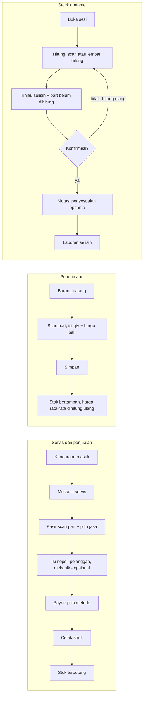
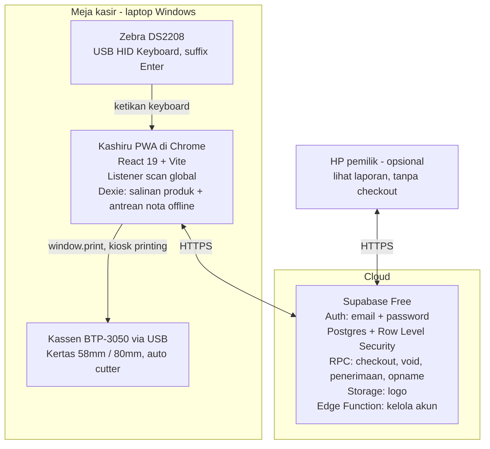

# PRD Kashiru (Revisi) — Aplikasi Kasir Bengkel & Sparepart

18 Oktober 2026 · Daffa Hanifisyafiq · Revisi 1, hasil sesi tanya-jawab desain atas `PRD-Kashiru.md`

Istilah baku ada di [GLOSSARY.md](./GLOSSARY.md), alasan keputusan besar ada di [docs/adr](./docs/adr), dan log tanya-jawab desain beserta saran yang ditolak ada di [CONTEXT.md](./CONTEXT.md). Ringkasan perubahan dari PRD awal ada di bagian 11.

## 1. Ringkasan Produk

Kashiru adalah aplikasi kasir berbasis web untuk satu bengkel motor/mobil kecil yang juga menjual part. Kashiru mencatat penjualan part dan jasa di kasir, stok part, penerimaan barang, dan stock opname.

**Prinsip cakupan**: Kashiru hanya mencatat penjualan kasir dan stok. Kashiru bukan alat pencatat kas, piutang, hutang, atau akuntansi.

**Masalah yang diselesaikan**

- Stok part sering tidak cocok antara catatan dan stok fisik, sehingga barang "ada di sistem" padahal kosong.
- Satu jenis part punya banyak kode (OEM, aftermarket, KW), sehingga sulit dicari cepat saat pelanggan menunggu.
- Nota jasa servis dan nota part terpisah, sehingga omzet bengkel sulit dihitung.
- Stock opname manual memakan waktu satu hari penuh dan rawan salah hitung.

**Visi**: kasir bengkel bisa menyelesaikan satu nota (scan part, pilih jasa, bayar, cetak) dalam kurang dari 60 detik, dan pemilik tahu nilai stok riil setiap saat.

**Tujuan & metrik sukses (6 bulan setelah rilis)**

| Tujuan | Metrik | Target |
| --- | --- | --- |
| Nota cepat | Waktu rata-rata dari scan pertama sampai struk tercetak | < 60 detik |
| Stok akurat | Selisih stok sistem vs fisik saat opname | < 2% part |
| Opname efisien | Durasi stock opname 1.000 part | < 3 jam |
| Tidak kehabisan barang | Part fast-moving yang habis per bulan | < 5 part |
| Adopsi | Penjualan harian yang tercatat di Kashiru | 100% |

## 2. Pengguna & Perangkat

- Kashiru dipasang untuk **satu bengkel**: satu instalasi memakai satu project Supabase ([ADR 0001](./docs/adr/0001-one-installation-per-workshop.md)).
- Bengkel memakai **laptop Windows** untuk semua pekerjaan: kasir, input stok, penerimaan, opname, cetak, dan scan. **Semua perangkat setara** (R50): siapa pun yang login bisa membuat nota dari laptop mana pun, online maupun offline. Yang dibedakan hanya akun yang login.
- Pemilik dan kasir login dengan **email + password**. Tidak ada peran: setelah login semua menu terbuka untuk setiap akun. Nama akun yang login dicatat di setiap nota, penerimaan, opname, dan riwayat perubahan.
- Pemilik boleh login dari HP untuk melihat laporan. Layar Kasir dirancang untuk laptop (PRD 6).
- Halaman awal: laptop (lebar layar 1024px ke atas) langsung membuka Kasir dengan fokus di kolom scan; HP membuka Dashboard (R51).
- Mekanik bukan pengguna aplikasi. Nama mekanik hanya dicatat sebagai data di nota.
- Aksi berisiko (void, penyesuaian stok, ubah harga jual, konfirmasi opname) cukup meminta konfirmasi dan tercatat di riwayat perubahan.

## 3. Ruang Lingkup

Semua modul di bawah dikerjakan dalam satu fase dan dirilis bersamaan.

| Modul | Catatan |
| --- | --- |
| Login & akun | Email + password di Supabase Auth, semua akun setara, ganti akun cepat |
| Master produk | Part & jasa, kategori satu tingkat, banyak barcode dan kode part per part, tanpa SKU |
| Stok & kartu stok | Buku mutasi, stok boleh minus, status stok, saran belanja |
| Penerimaan barang | Tanggal masuk, scan atau cari barang, qty, harga beli, void penerimaan (tanpa supplier, R52) |
| Stock opname | Penuh atau per kategori, blind count, lembar hitung, scan |
| Kasir (POS) | Tambah ke keranjang untuk menunda motor yang sedang diservis, diskon, satu metode bayar per nota, void |
| Scan barcode (Zebra DS2208) | Mode keyboard USB HID, tanpa driver |
| Barcode internal & label | Angka urut Code128 untuk part tanpa barcode pabrik, dicetak di printer struk |
| Cetak struk (Kassen BTP-3050) | 58mm atau 80mm sesuai pengaturan, cetak ulang "SALINAN" |
| Laporan & dashboard | Penjualan, laba kotor, jasa per mekanik, riwayat servis per nopol, stok, penerimaan, opname |
| Riwayat perubahan | Tidak bisa diedit atau dihapus |
| Mode offline | Hanya untuk membuat nota, sinkron otomatis ([ADR 0002](./docs/adr/0002-offline-sales-only.md)) |
| Backup | Backup manual dari Pengaturan (R44). Backup otomatis lewat GitHub Actions ditunda ([ADR 0005](./docs/adr/0005-supabase-free-github-actions-backup.md)) |

**Di luar cakupan**: work order dan papan antrean ([ADR 0003](./docs/adr/0003-no-work-orders.md)), retur penjualan dan pembelian, klaim garansi, buka/tutup hari, pencatatan kas (kas awal, kas keluar, selisih kas), PO dan hutang supplier, piutang/tempo, komisi mekanik, pengingat servis WhatsApp, struk digital, master pelanggan dan kendaraan, golongan harga, multi-satuan dengan konversi, kompatibilitas kendaraan, SKU, impor Excel, split payment, PPN, QZ Tray dan buka laci otomatis, tablet opname dan realtime antarperangkat, cycle count, peran dan hak akses, multi-cabang, booking online, e-Faktur, akuntansi, penggajian, dan aplikasi mobile native.

## 4. Fitur Inti

### 4.1 Login & Akun

Detail keputusan ada di [ADR 0006](./docs/adr/0006-email-login-without-sending-email.md).

- Login dengan **email + password**. Email boleh alamat biasa seperti Gmail. Setiap akun adalah user Supabase Auth. Password minimal 6 karakter.
- Akun pertama (pemilik) dibuat oleh skrip setup saat instalasi (7.7). Tidak ada layar pendaftaran di aplikasi. Akun berikutnya dibuat dari Pengaturan → Akun oleh akun mana pun, dengan email dan password awal. Akun langsung aktif tanpa email konfirmasi. Kashiru tidak pernah mengirim email.
- Nama tampilan akun (tercetak di struk sebagai kasir) bisa diubah oleh akun mana pun dari Pengaturan → Akun, termasuk nota lama yang dicetak ulang. Email tidak bisa diubah karena menjadi identitas login; kalau email salah, nonaktifkan akun itu dan buat akun baru.
- Ganti password sendiri lewat tombol **Password baru** di baris akun sendiri di Pengaturan → Akun, tanpa password lama dan tanpa menu terpisah.
- Lupa password: akun lain membuat password baru dari Pengaturan → Akun. Tidak ada reset lewat email. Kalau akun aktif tinggal satu, developer meresetnya dari dashboard Supabase.
- Akun bisa dinonaktifkan, misalnya saat kasir berhenti atau perangkat hilang. Akun tidak bisa menonaktifkan dirinya sendiri, sehingga selalu ada minimal satu akun aktif. Akun nonaktif bisa diaktifkan lagi oleh akun mana pun, misalnya saat kasir lama kembali bekerja.
- Sesi tersimpan di perangkat. Logout otomatis berjalan setelah tidak ada aktivitas selama waktu yang bisa diatur (default 12 jam), dan ditunda selama offline.
- Tombol **Ganti akun** di pojok layar untuk bergantian akun di laptop yang sama. Isian layar Kasir dan keranjang tetap ada saat ganti akun. Ganti akun tidak bisa dilakukan saat offline.
- Ganti akun dan logout otomatis hanya mengeluarkan akun dari perangkat itu. Sesi akun yang sama di perangkat lain, misalnya HP pemilik, tetap jalan.
- Akun yang dinonaktifkan juga diblokir di Supabase Auth, sehingga tidak bisa login atau memperpanjang sesi. Datanya sudah tertutup oleh RLS sejak saat itu.

### 4.2 Master Produk

Produk terdiri dari **Part** (punya stok) dan **Jasa** (tanpa stok). Kashiru tidak memakai SKU. Produk dikenali dari nama, merek, dan barcode-nya.

Part dikelola di menu **Produk**, jasa di menu **Jasa** (masing-masing dengan daftar dan form sendiri). Jasa yang belum terdaftar tidak perlu ditambahkan dulu: kasir bisa mengetiknya sebagai jasa manual (4.6).

| Data | Part | Jasa |
| --- | --- | --- |
| Nama | Wajib | Wajib |
| Kategori | Wajib | Wajib (mis. "Jasa Servis") |
| Harga jual | Wajib | Wajib, sebagai tarif default |
| Merek | Opsional | Tidak ada |
| Satuan | Opsional (pcs, liter, meter, dll.; default pcs), dengan tanda "bisa pecahan" | Tidak ada |
| Stok minimum | Opsional (0 = tidak dipantau) | Tidak ada |
| Barcode (banyak) & kode part (banyak) | Opsional | Tidak ada |
| Stok awal & harga beli | Hanya saat part dibuat | Tidak ada |

- **Pembeda**: gabungan nama + merek tidak boleh sama dengan produk lain (tanpa membedakan huruf besar-kecil). Merek tampil di samping nama di hasil pencarian dan struk, mis. "Kampas Rem Depan Vario 125 · Federal".
- **Kategori** hanya satu tingkat, tanpa sub-kategori dan tanpa lokasi rak. Daftarnya dimulai kosong. Kategori bisa dibuat langsung dari form produk: ketik nama, lalu pilih "+ Buat kategori '…'". Mengubah nama atau menonaktifkan kategori dilakukan di Pengaturan → Kategori. Kategori yang masih dipakai produk aktif boleh dinonaktifkan: produknya tetap memakai kategori itu dan tetap bisa dijual, dicari, dan dilaporkan. Kategori nonaktif hanya hilang dari pilihan saat membuat produk dan saat memilih sesi opname per kategori. Saat produk lama diedit, kategorinya tetap tampil dengan tanda "nonaktif" dan boleh dipertahankan.
- **Banyak barcode per part**: barcode pabrik (EAN-13 / Code128) dan barcode internal (4.9). Setiap barcode unik di seluruh produk.
- **Kode part** (OEM, aftermarket, KW) disimpan hanya sebagai kode tambahan yang bisa dicari.
- **Satuan** satu per produk. Qty pecahan (mis. 1,5 liter atau 2,3 meter) hanya boleh untuk part bertanda "bisa pecahan", maksimal 2 angka di belakang koma. Qty ditampilkan tanpa nol di belakang (0,8, bukan 0,80).
- **Harga jual** part wajib lebih dari Rp 0. Tarif jasa boleh Rp 0 untuk jasa gratis, misalnya cek kendaraan. Part gratis diberikan lewat diskon 100%, supaya laba kotor tetap menunjukkan nilai part yang diberikan.
- **Harga beli** tidak diisi di form produk, kecuali saat part dibuat. Harga beli rata-rata dihitung dari stok awal dan penerimaan.
- **Stok awal**: saat membuat part baru, form menyediakan kolom stok awal dan harga beli. Keduanya boleh kosong, tetapi kalau stok awal diisi, harga beli wajib diisi dan harus lebih dari Rp 0. Kashiru lalu membuat mutasi "stok awal", dan harga belinya menjadi harga beli rata-rata pertama. Kalau stok awal kosong, harga beli rata-rata diambil dari penerimaan pertama. Kalau harga beli lebih tinggi dari harga jual, muncul peringatan "Harga jual di bawah harga beli", tapi part tetap bisa disimpan. Setelah part dibuat, stok hanya berubah lewat nota, penerimaan, opname, atau penyesuaian stok.
- **Input data awal manual dengan scanner**: scan barcode part yang belum dikenal, lalu form "Produk baru" terbuka dengan barcode sudah terisi. Isi data, lalu tekan **Simpan & berikutnya**, dan fokus kembali ke scan. Tipe dan kategori dipertahankan untuk produk berikutnya, supaya input beruntun satu kategori lebih cepat. Part tanpa barcode dibuat tanpa barcode, lalu langsung diberi barcode internal dari form yang sama.
- **Produk tidak bisa dihapus**, hanya dinonaktifkan, karena nota lama masih merujuk ke produk itu. Part boleh dinonaktifkan walaupun stoknya bukan 0; dialog konfirmasi menampilkan peringatan "Stok masih 5", dan stoknya dibiarkan apa adanya (tetap terhitung di nilai persediaan, tetapi tidak muncul di kasir, pencarian, dan opname penuh). Produk nonaktif bisa diaktifkan lagi.
- Mengubah harga jual di master meminta konfirmasi dan tercatat di riwayat perubahan.

### 4.3 Stok & Kartu Stok

Stok dihitung dari buku mutasi (ledger), bukan angka yang diedit langsung, sehingga setiap perubahan bisa dilacak.

- **Jenis mutasi**: stok awal, jual, void jual, beli (penerimaan), void beli, penyesuaian opname, dan penyesuaian stok.
- **Kartu stok per part** berisi tanggal, jenis mutasi, nomor dokumen, qty masuk/keluar, saldo, HPP, dan akun.
- **Stok boleh minus**. Kasir tetap bisa menjual melebihi stok setelah konfirmasi, karena nota tidak boleh tertahan oleh stok sistem yang belum benar. Penyebabnya biasanya penerimaan yang belum diinput.
- **Status stok** untuk part yang stok minimumnya diisi:

  | Status | Kondisi | Warna |
  | --- | --- | --- |
  | Aman | stok > stok minimum | hijau |
  | Menipis | 0 < stok ≤ stok minimum | kuning |
  | Habis | stok = 0 | merah |
  | Minus | stok < 0 | merah, dengan tanda "perlu dicek" |

  Part dengan stok minimum 0 hanya bisa berstatus Habis atau Minus.
- **Saran belanja** adalah daftar part berstatus Menipis, Habis, atau Minus. Setiap baris berisi harga beli terakhir dan usulan qty = (stok minimum × 2) − stok saat ini. Daftar ini bisa dicetak ke printer struk atau diekspor ke Excel, dan sifatnya hanya catatan karena tidak ada PO.
- **Penyesuaian stok** dipakai untuk barang rusak, hilang, ketemu, atau salah input di luar opname. Alasan wajib dipilih dari daftar Rusak, Hilang, Ketemu, Salah input, atau Lainnya, ditambah keterangan teks yang opsional (wajib untuk Lainnya). Penyesuaian perlu konfirmasi dan tercatat di riwayat perubahan. Penyesuaian tambah pada part tanpa harga rata-rata wajib disertai harga beli.
- **Valuasi stok** memakai harga beli rata-rata tertimbang (average cost):
  - Penerimaan saat stok > 0: rata-rata baru = (stok × rata-rata lama + qty × harga beli) ÷ (stok + qty).
  - Penerimaan saat stok ≤ 0: rata-rata baru = harga beli penerimaan itu, kecuali baris Rp 0 (barang bonus) yang tidak mengubah rata-rata, supaya rata-rata tidak menjadi Rp 0.
  - Void penerimaan: rata-rata dihitung ulang seolah penerimaan itu tidak pernah ada, yaitu dengan menghitung ulang seluruh mutasi part itu dari awal tanpa penerimaan yang sudah di-void. Rumus balik (nilai stok − nilai penerimaan) tidak dipakai, karena bisa menghasilkan rata-rata negatif kalau part sudah terjual. Kalau sisa stok setelah void ≤ 0, rata-rata tidak diubah.
  - Void nota: stok kembali dengan HPP dari nota asal dan ikut dihitung ke rata-rata tertimbang seperti penerimaan.
  - Opname lebih dan penyesuaian tambah: stok masuk dengan harga rata-rata saat itu, jadi rata-ratanya tidak berubah. Kalau part belum punya harga rata-rata (Rp 0), harga beli wajib diisi di baris itu sebelum dikonfirmasi, dan harga itu menjadi rata-rata pertamanya.
  - Mutasi keluar (jual, opname kurang, penyesuaian kurang) tidak mengubah rata-rata. Void beli mengikuti aturan void penerimaan di atas.
- **Pencarian kilat** lewat nama, merek, barcode, atau kode part, dengan filter kategori. Pencarian dijalankan dari salinan produk di laptop (4.13).
- **Laporan slow-moving**: part aktif dengan stok > 0 yang tidak terjual dalam 90 hari terakhir (termasuk yang belum pernah terjual) dan sudah terdaftar lebih dari 90 hari, dengan tanggal terakhir terjual, stok, dan nilai persediaan, diurutkan dari nilai persediaan terbesar. **Fast-moving**: 20 part dengan qty terjual terbanyak pada periode filter, dengan omzet, laba kotor, dan stok sekarang; nota void tidak dihitung (R29).

### 4.4 Penerimaan Barang

Penerimaan adalah satu-satunya jalan stok masuk selain stok awal dan penyesuaian.

- **Tanpa supplier** (R52): penerimaan hanya mencatat tanggal masuk dan barangnya. Supplier dan nomor faktur supplier tidak dipakai lagi; data supplier lama tetap tersimpan di database.
- **Satu penerimaan** berisi nomor (`TRM-YYYYMMDD-0001`), tanggal masuk, dan baris part (qty dan harga beli).
- **Tanggal masuk** default hari ini dan boleh diisi tanggal mundur. Kolom ini hanya keterangan dan dipakai untuk laporan penerimaan per periode. Mutasi stok dan perhitungan harga rata-rata selalu dibukukan pada waktu penerimaan disimpan, sehingga kartu stok selalu urut dan HPP nota yang sudah dibuat tidak berubah.
- Baris diisi dengan **scan** (setiap scan menambah qty 1) atau dengan mengetik qty. Harga beli per baris otomatis terisi harga beli terakhir dan bisa diubah.
- **Barang bonus** dicatat sebagai baris terpisah dengan harga beli Rp 0, misalnya "Oli MPX, qty 1, Rp 0", dan ikut dihitung ke rata-rata tertimbang (lihat 4.3). Di dalam satu penerimaan, baris Rp 0 dibukukan setelah baris yang berharga, sehingga urutan scan tidak memengaruhi hasil.
- **Saat disimpan**, setiap baris membuat mutasi "beli", dan harga beli rata-rata dihitung ulang.
- **Penerimaan tidak pernah diedit.** Kalau salah, penerimaan di-**void**: seluruh penerimaan dibatalkan, alasan wajib diisi, perlu konfirmasi, dan tercatat di riwayat perubahan. Void membuat mutasi "void beli". Stok boleh jadi minus karenanya. HPP di nota yang sudah dibuat sebelumnya tidak diubah. Setelah itu penerimaan diinput ulang dengan benar.
- Penerimaan wajib online.

### 4.5 Stock Opname

Opname dilakukan per sesi dengan alur hitung → tinjau → konfirmasi. Stok sistem baru berubah setelah sesi dikonfirmasi.

- **Jenis sesi**: **penuh** (semua part aktif) atau **per kategori**. Hanya satu sesi yang boleh terbuka pada satu waktu. Nomor sesi: `OPN-YYYYMMDD-01`.
- **Blind count**: stok sistem disembunyikan di layar hitung. Mode ini bisa dimatikan di Pengaturan.
- **Cara menghitung**:
  - Scan barcode: setiap scan menambah qty 1. Laptop dan scanner bisa dibawa ke dekat stok fisik.
  - Cari part (nama atau scan), lalu ketik qty untuk jumlah besar.
  - **Lembar hitung**: dari layar sesi bisa dicetak lembar hitung per kategori ke printer struk atau diekspor ke PDF. Isinya nama, merek, satuan, dan kolom kosong untuk qty, tanpa stok sistem. Hasil tulisan tangan lalu diinput, dengan daftar part yang urutannya sama seperti di lembar hitung.
- **Penjualan dan penerimaan tetap boleh selama sesi terbuka.** Setiap part yang dihitung menyimpan waktu terakhir dihitung dan stok sistem pada waktu itu.
  - **Selisih = qty hitung − stok sistem pada waktu part itu terakhir dihitung.**
  - Contoh: sesi dibuka pukul 09:00 dengan stok Oli MPX 10. Oli dihitung pukul 09:20 sebanyak 10. Pukul 10:00 terjual 2. Selisihnya 10 − 10 = 0, dan stok akhir tetap 8.
  - Untuk part yang diisi dari lembar hitung, waktu hitung adalah saat qty diinput. Hindari menjual part itu di antara saat dihitung dan saat diinput.
- **Input hitungan wajib online, dan tidak boleh ada nota yang belum terkirim atau gagal terkirim**, supaya stok sistem pada waktu hitung sudah lengkap. Kalau masih ada, layar opname menampilkan "Ada N nota belum terkirim. Selesaikan dulu sebelum menghitung" dengan tautan ke daftar nota tersebut. Pemeriksaan ini hanya melihat antrean laptop yang sedang dipakai, jadi laptop lain yang dipakai kasir harus sudah online dan terkirim (R50).
- **Tinjau**: daftar selisih per part dalam qty dan rupiah (selisih × harga beli rata-rata), plus daftar part dalam cakupan sesi yang belum dihitung. Untuk part yang belum dihitung, kasir memilih per part atau sekaligus apakah dianggap 0 atau dilewati (stoknya tidak diubah).
- **Alasan selisih** per part: Rusak, Hilang, Ketemu, Salah input, atau Lainnya (daftar yang sama dengan penyesuaian stok). Alasan wajib untuk setiap part yang selisihnya bukan 0 sebelum sesi bisa dikonfirmasi, dan bisa diisi sekaligus untuk beberapa baris yang dipilih. "Lainnya" wajib disertai keterangan teks. Laporan opname bisa menjumlahkan selisih per alasan.
- **Selisih lebih pada part tanpa harga rata-rata** (Rp 0): harga beli wajib diisi di baris itu sebelum sesi bisa dikonfirmasi (lihat 4.3).
- **Konfirmasi** membuat mutasi "penyesuaian opname" sebesar selisih untuk setiap part, ditambahkan ke stok saat itu. Konfirmasi tercatat di riwayat perubahan. Sesi yang sudah dikonfirmasi tidak bisa dibatalkan, jadi kesalahan diperbaiki lewat penyesuaian stok atau opname berikutnya.
- **Batalkan sesi**: sesi yang masih terbuka bisa dibatalkan dengan konfirmasi, dan tercatat di riwayat perubahan. Stok tidak berubah sama sekali. Hasil hitungannya tetap tersimpan dan ditandai "Dibatalkan".
- **Ekspor** hasil opname ke PDF dan Excel.

### 4.6 Kasir (POS)

Layar kasir dipakai dengan scanner dan mouse, tanpa pintasan keyboard (R60). Alur bengkel: kendaraan masuk dan diservis. Part dan jasa boleh dicatat sedikit demi sedikit selama servis berjalan supaya tidak lupa, ditunda di keranjang dengan keterangan saat kendaraan lain dilayani, lalu dibayar sekaligus saat selesai (R57, R63).

- **Keranjang** berisi baris part (punya stok) dan baris jasa (tanpa stok).
- **Jasa manual**: jendela Jasa (tombol di kanan Katalog) punya isian nama jasa dan tarif untuk jasa yang belum ada di menu Jasa. Jasa manual hanya tercatat di baris nota (tanpa produk, tanpa stok, tetap bisa offline), tidak masuk daftar jasa. Nama wajib (maks. 100 huruf), tarif boleh Rp 0. Nama dan tarif yang sama menambah qty barisnya. Di laporan, jasa manual dihitung sebagai omzet jasa dengan kategori "Jasa manual", dan per produk dikelompokkan per nama.
- **Qty jasa** berupa bilangan bulat ≥ 1, misalnya tambal ban 2 roda. Tombol + / − dan memilih jasa yang sama dari kolom cari menambah qty, sama seperti part.
- **Data nota opsional** (tombol Ubah di panel Data nota): nopol, nama pelanggan, **keterangan** (teks bebas penanda kendaraan atau pemiliknya, mis. "Vario hitam", R58; wajib saat Tambah ke keranjang; hanya di laptop dan struk, tidak tersimpan di server, R62), satu mekanik untuk seluruh nota, dan catatan servis berikutnya (mis. "Ganti oli berikutnya: 21.000 km"). Semuanya boleh kosong. Mekanik baru bisa dibuat langsung dari isian mekanik ("+ Buat mekanik '…'"), kecuali saat offline.
- **Nopol**:
  - Disimpan dalam format baku, yaitu huruf besar dengan satu spasi di antara kelompok huruf dan angka. Contohnya `b1234xyz` tersimpan sebagai `B 1234 XYZ`.
  - Format resmi tidak dipaksakan. Nopol yang tidak biasa tetap bisa diketik bebas.
  - Pencarian riwayat mengabaikan spasi dan huruf besar-kecil.
  - Begitu nopol yang pernah ada diketik, nama pelanggan dari nota terakhir dengan nopol itu terisi otomatis dan tetap bisa diubah.
- **Harga**:
  - Harga jasa diambil dari tarif di master dan boleh diubah langsung di keranjang tanpa konfirmasi, termasuk menjadi Rp 0.
  - Harga part tidak bisa diubah di keranjang. Potongan diberikan lewat diskon.
- **Diskon**:
  - Diskon per baris (part atau jasa) dan diskon per nota, dalam bentuk nominal atau persen.
  - Diskon per baris diisi **langsung di kolom Diskon** tabel keranjang (R55): angka berarti rupiah untuk total baris (`2000` atau `2.000`), akhiran `%` berarti persen (`10%`, `2,5%`), kosong berarti tanpa diskon. Diterapkan saat Enter, Tab, atau pindah fokus; Esc membatalkan (perilaku isian, bukan pintasan). Isian yang salah (bukan angka, persen di luar 0–100 atau lebih dari 2 desimal, melebihi jumlah baris) ditolak dengan pesan di bawah isian dan diskon lama tetap berlaku.
  - Diskon nominal per baris berlaku untuk total baris, bukan per satuan. Contoh: 3 × Rp 52.000 dengan diskon Rp 2.000 menjadi Rp 154.000.
  - Diskon tidak boleh membuat harga di bawah Rp 0.
  - Kalau harga part setelah diskon di bawah HPP, diskon tetap diterapkan dan baris itu diberi peringatan "Di bawah harga beli (Rp …)", tanpa konfirmasi terpisah (R55).
  - Diskon nota dialokasikan ke setiap baris sebanding nilainya, untuk laba kotor per kategori dan per produk. Alokasi tiap baris dibulatkan ke bawah, lalu sisa rupiahnya dibagikan satu per satu ke baris dengan pecahan terbesar, sehingga alokasi tidak pernah melebihi nilai baris.
  - Diskon tersimpan di nota bersama akun pembuatnya, tanpa catatan riwayat terpisah.
- **Validasi stok**: peringatan kalau qty melebihi stok, tapi kasir tetap bisa lanjut setelah konfirmasi (stok boleh minus). Qty part yang sama di keranjang yang ditunda ikut dihitung dan disebutkan, mis. "Sudah ada juga di keranjang B 1234 XYZ (1)". Ini hanya peringatan; stok tidak ditahan (ADR 0003, R59). Kotak Katalog menampilkan stok sistem ditambah keterangan "1 di keranjang".
- **Layar dan keranjang** (R57, R61, R63):
  - Layar Kasir berisi **satu isian** yang sedang dikerjakan. Isian ini bukan keranjang dan tidak diberi nama khusus; saat kosong tertulis "Belum ada barang".
  - **Tambah ke keranjang** (tombol garis selebar Bayar, tepat di bawahnya, nonaktif saat layar kosong) membuka jendela dengan satu isian **Keterangan** yang selalu wajib. Isiannya diusulkan dari keterangan, lalu nopol, lalu nama pelanggan yang sudah diisi. Keterangan harus unik di antara keranjang yang ada (huruf besar-kecil dan spasi diabaikan): "Sudah ada keranjang Vario hitam. Pakai keterangan lain, mis. tambahkan nopol atau nama pemilik." Setelah ditambahkan, layar bersih untuk pelanggan berikutnya.
  - Contoh: motor A ganti oli, oli di-scan. Motor B datang untuk ganti roller, jadi kasir menekan Tambah ke keranjang, mengisi "Vario hitam", dan layar bersih untuk motor B.
  - **Ikon keranjang** di pojok kanan atas layar Kasir, sejajar judul, dengan angka merah jumlah keranjang yang ditunda seperti di marketplace. Angkanya disembunyikan kalau 0.
  - Klik ikon membuka **modal Keranjang**. Kiri: daftar keranjang urut waktu isiannya mulai dibuat, masing-masing dengan keterangan, jumlah baris, dan total; yang paling atas langsung terpilih. Kanan: isi keranjang terpilih (keterangan, nopol, pelanggan, mekanik, jam dibuat, barang dengan qty × harga dan diskon, total), hanya untuk dilihat. Tombolnya **Tutup** dan **Buka keranjang**. Kalau belum ada keranjang, modal menampilkan "Belum ada keranjang".
  - **Buka keranjang** memindahkan isi keranjang ke layar dan mengeluarkannya dari daftar (angka di ikon berkurang). Kalau layar masih berisi barang, jendela Tambah ke keranjang muncul dulu ("Tambahkan dulu ke keranjang sebelum membuka keranjang Vario hitam", tombol **Tambahkan dan buka**). Layar tidak pernah tertimpa. Setelah dibuka, kasir menambah barang lalu **Bayar**, atau **Tambah ke keranjang** lagi dengan keterangan yang sudah terisi.
  - **Bayar** menyelesaikan isian layar. **Kosongkan** (di bawah tabel) membuang isian layar setelah konfirmasi "Hapus 3 baris di layar?". Kalau isiannya berasal dari keranjang yang dibuka, konfirmasinya menyebut bahwa keranjang itu ikut terbuang. Setelah keduanya, layar bersih.
  - Isian layar dan semua keranjang disimpan **hanya di laptop** (R62): tetap aman saat offline, saat browser tertutup, dan saat ganti akun, belum punya nomor, tidak mengurangi stok, dan tidak terlihat dari laptop lain.
  - Setiap kali keranjang dibuka, harga part diperbarui ke harga terbaru di master. Baris yang berubah ditandai, misalnya "Harga berubah: Rp 50.000 → Rp 52.000". Harga jasa yang sudah diubah manual tidak ikut diperbarui. Produk yang sudah dinonaktifkan ditandai dan harus dihapus sebelum bayar. Pemeriksaan yang sama diulang saat Bayar ditekan; kalau ada yang berubah, layar diperbarui dan jendela bayar belum dibuka supaya kasir memeriksanya dulu.
  - Keranjang aktif dan keranjang ditahan dari versi sebelumnya dipindah otomatis: keranjang aktif menjadi isian layar, keranjang ditahan masuk daftar dengan keterangan dari nopol, nama pelanggan, atau label lamanya (diberi nomor kalau sama).
- **Bayar**:
  - Pilih satu metode bayar: **Tunai, QRIS, Transfer, atau EDC**. Metode bayar hanya catatan. Tidak ada split payment, tidak ada integrasi dengan penyedia pembayaran, dan tidak ada kolom referensi.
  - **Tunai**: isi uang diterima, dibantu tombol Uang pas dan pecahan cepat (Rp 20.000, Rp 50.000, Rp 100.000). Kembalian dihitung otomatis.
  - **Metode lain**: nominal otomatis sama dengan total.
  - Setelah bayar, nota tersimpan, stok terpotong, struk tercetak, dan fokus kembali ke kolom scan di keranjang kosong.
- **Tanpa PPN**. Total = subtotal − diskon.
- **Pembulatan**: hasil qty pecahan × harga dan setiap diskon persen dibulatkan ke rupiah terdekat (≥ 0,5 ke atas), per baris dan per diskon. Total tidak dibulatkan lagi ke ratusan.
- **Tanpa pintasan keyboard** (R60): semua aksi lewat tombol yang diklik (Katalog, Jasa, Ubah, Bayar, Tambah ke keranjang, Ubah qty, Diskon, Diskon nota, Cetak ulang, Kosongkan, ikon keranjang, tombol − / + dan × di tiap baris). Yang tetap jalan hanyalah perilaku dasar: scanner (mengetik barcode lalu Enter), Enter dan ↑ / ↓ di kolom cari untuk memilih hasil, Enter untuk mengirim isian dalam jendela, Esc untuk menutup jendela, dan Tab untuk pindah isian. Tombol tidak mencantumkan nama tombol keyboard. Mengklik angka qty membuka isian qty, mis. `1,5` untuk part bisa pecahan atau `10` untuk baut.

- **Nomor nota**: `{AWALAN}-{YYYYMMDD}-{URUT}`, mis. `KSR-20261018-0001`.
  - Awalan bisa diatur di Pengaturan.
  - Tanggal adalah tanggal nota dibuat menurut jam laptop (WIB).
  - Nomor urut dimulai dari 0001 setiap hari dan dibuat oleh laptop yang membuat nota, online maupun offline. Kalau dua laptop memakai nomor yang sama, server memberi nomor kosong berikutnya (7.5, R50).
  - Mengganti awalan tidak mengulang nomor urut.
- **Riwayat nota**: cari nota lewat nomor, tanggal, nopol, atau nama pelanggan, lalu cetak ulang atau void. Keterangan tidak tersimpan di server, jadi tidak ada di riwayat dan tidak ikut di cetak ulang dari Riwayat nota (R62).

### 4.7 Void Nota

- Void membatalkan **seluruh nota**. Nota tidak pernah diedit; perbaikan dilakukan dengan void lalu membuat nota baru yang benar.
- Void bisa untuk nota dari tanggal berapa pun. Alasan wajib diisi, perlu konfirmasi, dan tercatat di riwayat perubahan.
- Stok part kembali lewat mutasi "void jual" pada tanggal void, memakai HPP dari nota asal.
- Pengembalian uang ke pelanggan tidak dicatat, karena Kashiru tidak mencatat kas.
- Laporan penjualan per tanggal nota tidak menghitung nota yang di-void. Nota void tetap tampil di daftar nota dengan tanda.
- Void wajib online. Nota offline harus tersinkron dulu.

### 4.8 Scan Barang (Zebra DS2208)

Scanner dipasang di mode USB HID Keyboard, sehingga browser menerima hasil scan sebagai ketikan keyboard tanpa driver tambahan ([referensi mode HID & CDC](https://www.cleverence.com/articles/usb-barcode-scanners-de/quick-steps-to-enable-usb-hid-mode-on-ds2208-5837291/)).

- **Konfigurasi scanner**: USB HID Keyboard, suffix Enter (CR), dan layout keyboard US. USB HID Keyboard dan layout US adalah bawaan pabrik DS2208; Enter harus ditambahkan dengan memindai "Add Enter Key (Carriage Return/Line Feed)". Pengaturan → Scanner menampilkan ketiga setelan ini dengan rujukan halaman di panduan resmi Zebra (barcode setelannya tidak dibuat ulang di Kashiru karena berisi kode khusus Zebra), plus **Uji scan** untuk memastikan setelannya benar (R49).
- **Deteksi scan global**: listener membedakan scan dari ketikan manusia lewat kecepatan (jeda < 30 ms per karakter, diakhiri Enter, panjang ≥ 4).
- **Perilaku scan per layar**:

  | Layar | Hasil scan |
  | --- | --- |
  | Kasir | Menambah part ke keranjang. Scan barcode yang sama = qty +1 |
  | Opname | Menambah hitungan +1 |
  | Penerimaan | Menambah qty terima +1 |
  | Form produk | Mengisi kolom barcode |

- **Barcode tidak dikenal**: muncul dialog "Daftarkan produk baru" atau "Tautkan ke produk yang ada". Saat offline, produk baru tidak bisa dibuat, dan muncul pesan "Produk baru hanya bisa dibuat saat online".
- Kalau fokus sedang di input teks biasa, scan tetap ditangkap dan karakternya tidak masuk ke input itu.
- **Umpan balik**: bunyi beep sukses/gagal di aplikasi, plus kilatan visual pada baris yang berubah.
- **Format yang didukung**: 1D EAN-13 dan Code128.

### 4.9 Barcode Internal & Label

Untuk part tanpa barcode pabrik, misalnya baut.

- Tombol **"Buat barcode internal"** di part membuat **angka urut otomatis**, misalnya `200001`, `200002`, dan seterusnya, dengan jenis **Code128**. Hanya angka, supaya tidak terpengaruh Caps Lock di laptop kasir.
- Part yang sudah punya barcode pabrik tetap bisa diberi barcode internal juga, dan keduanya sama-sama bisa di-scan.
- **Isi label**: nama part dan merek (dipotong kalau terlalu panjang), barcode, dan angka kode dalam bentuk teks. **Harga tidak dicetak.**
- **Cetak**: dari halaman part, tekan Cetak label, pilih barcode kalau ada lebih dari satu, isi jumlah label, lalu cetak ke BTP-3050 di kertas yang terpasang (kertas struk atau gulungan stiker thermal 58/80mm). Kertas dipotong otomatis setelah semua label selesai dicetak. Tata letak label saat ini dibuat untuk gulungan kontinu dan disesuaikan setelah uji printer (Fase 0).
- **Menu Label barcode**: daftar semua barcode internal milik part aktif (cari nama/merek/barcode, filter kategori). Centang beberapa part, isi jumlah label per part (1–200), lalu cetak semuanya sekaligus dalam satu gulungan.

### 4.10 Cetak Struk (Kassen BTP-3050)

BTP-3050 adalah printer thermal ESC/POS yang mendukung kertas 80mm dan 58mm, 203 DPI, dan auto cutter ([spesifikasi](https://mymegatronix.co.id/btp-3050-bt-ue-2-sku/), [Kassen](https://kassen.com.tw/products/receipt-printer/btp-3050/)). Printer dihubungkan ke laptop lewat USB.

| Ukuran kertas | Lebar area cetak | Lebar (dot, 203 DPI) | Karakter per baris (Font A) |
| --- | --- | --- | --- |
| 58mm | ±48mm | 384 | 32 |
| 80mm (default) | 72mm | 576 | 48 |

- **Ukuran kertas dipilih sekali di Pengaturan** (58 atau 80mm, default 80mm). Semua cetakan mengikuti pengaturan itu: struk, label barcode, lembar hitung, saran belanja, dan ringkasan harian.
- **Jalur cetak** adalah driver Windows + `window.print()`. Template struk berupa HTML dengan CSS `@page { size: 80mm auto }` atau `58mm auto`. Chrome dijalankan dengan flag `--kiosk-printing` supaya tidak muncul dialog cetak. Auto cut diatur di driver.
- **Pengaturan cetak**: ukuran kertas dan jumlah salinan (default 1).
- **Cetak ulang** dari riwayat nota, dengan tanda **"SALINAN"**.
- Kalau printer bermasalah, nota tetap tersimpan dan bisa dicetak ulang setelah printer normal. Tidak ada struk digital.
- **Isi struk** (baris yang kosong tidak dicetak). Baris `Ket` berasal dari keranjang di laptop dan hanya ada di struk yang dicetak saat bayar dan di cetak ulang struk terakhir dari layar Kasir (R62):

```
        [LOGO BENGKEL - opsional]
           BENGKEL MAJU JAYA
     Jl. Raya Bogor No. 12, Depok
           0812-3456-7890
------------------------------------------------
No   : KSR-20261018-0007
Tgl  : 18/10/2026 14:32
Kasir: Rina
Nopol: B 1234 XYZ
Plg  : Pak Budi
Ket  : Vario hitam
Mek  : Andi
------------------------------------------------
PART
Kampas Rem Depan Vario · Federal
  1 x 45.000                          45.000
Oli MPX 1L · AHM
  1 x 52.000                          52.000
  Diskon                              -2.000
JASA
Servis rem                            35.000
------------------------------------------------
Subtotal                             130.000
Diskon nota                           -5.000
TOTAL                             Rp 125.000
Tunai                             Rp 150.000
Kembali                            Rp 25.000
------------------------------------------------
Ganti oli berikutnya: 21.000 km
     [catatan footer dari Pengaturan]
        Terima kasih atas kunjungan Anda
```

- Baris jasa dengan qty 1 dicetak satu baris seperti contoh di atas. Kalau qty lebih dari 1, jasa dicetak dengan baris rincian `2 x 15.000` seperti part.
- Template struk ditulis sekali sebagai komponen React yang menerima prop `paperWidth` (58 atau 80), sehingga lebar kolom, ukuran font, dan pemotongan teks menyesuaikan otomatis.

### 4.11 Laporan & Dashboard

**Dashboard (hari ini)**

**Omzet** di dashboard dan semua laporan adalah yang dibayar pelanggan, setelah diskon baris dan diskon nota. Omzet part dan jasa dipisah memakai alokasi diskon nota per baris, jadi jumlah keduanya sama dengan total nota. Laba kotor = omzet − HPP; jasa tidak punya HPP. Laporan penjualan menampilkan total diskon sebagai kolom tersendiri (R28).

- Omzet hari ini (part dan jasa terpisah) dan laba kotor hari ini.
- Pemberitahuan kalau backup terakhir lebih dari 7 hari lalu atau belum pernah ada (R47).
- Jumlah nota dan jumlah kendaraan (nopol berbeda).
- Jumlah part Menipis, Habis, dan Minus. Setiap angka bisa diklik ke layar Stok dengan filter itu; tab Status stok responsif untuk HP (R36).
- Grafik omzet 30 hari terakhir: batang per hari dengan part dan jasa bertumpuk; hari tanpa penjualan tetap tampil (R36).
- Peringatan "Nota gagal terkirim" kalau ada, hanya di laptop yang membuat nota itu karena antrean nota tersimpan di laptop itu (R31).

**Laporan (dengan filter periode)**

Satu menu Laporan berisi 7 laporan sebagai tab (dropdown di HP). Filter periode dipakai bersama dan tersimpan di alamat: Hari ini, Kemarin, 7 hari terakhir, Bulan ini (default), Bulan lalu, atau Pilih tanggal. Periode memakai tanggal WIB: tanggal nota untuk penjualan, tanggal masuk untuk penerimaan, dan tanggal konfirmasi untuk opname. Riwayat servis tidak memakai periode. Di laporan Stok, nilai persediaan dan slow-moving selalu saat ini, hanya fast-moving yang mengikuti periode (R33).

| Laporan | Isi |
| --- | --- |
| Penjualan | Ringkasan (jumlah nota, omzet part, omzet jasa, total diskon, total), per hari, per kategori, per metode bayar, dan daftar nota. Nota void ditandai dan tidak dihitung |
| Laba kotor | Ringkasan (omzet, HPP, laba kotor, margin), per hari, per kategori, per produk (part dan jasa, urut laba terbesar): (harga − diskon baris − alokasi diskon nota) − HPP |
| Jasa per mekanik | Jumlah nota dan total omzet jasa per mekanik, dengan baris "Tanpa mekanik" |
| Riwayat servis | Semua nota untuk satu nopol, terbaru di atas: tanggal, nomor, mekanik, catatan servis, rincian part/jasa, total. Nota void ditandai |
| Stok | Nilai persediaan (stok × harga beli rata-rata; stok minus dihitung 0 dan ditandai "perlu dicek", part tanpa harga beli rata-rata ditandai, R30) total, per kategori, dan per part dengan tautan ke kartu stok; slow-moving; fast-moving |
| Penerimaan | Ringkasan (jumlah dan total nilai) dan daftar penerimaan per periode tanggal masuk. Penerimaan void ditandai dan tidak dihitung |
| Opname | Sesi yang dikonfirmasi dalam periode: cakupan, part berselisih, selisih lebih, kurang, dan bersih dalam rupiah, serta total selisih per alasan dalam qty dan rupiah. Sesi batal tidak dihitung |

- Semua laporan bisa diekspor ke **Excel** (satu sheet per bagian) dan **PDF** (bagian berurutan) (R34). File dibuat di browser lalu diunduh, tidak lewat dialog cetak, sehingga cara kerjanya sama di laptop kasir yang memakai kiosk printing dan di HP. Berlaku juga untuk lembar hitung dan hasil opname (R22).
- **Ringkasan harian** untuk tanggal mana pun bisa dicetak ke printer struk dari Riwayat nota, memakai tanggal yang sedang dipilih. Isinya jumlah nota, omzet part dan jasa, total per metode bayar, dan nota void (nota bertanggal hari itu yang sudah di-void, jumlah dan totalnya), tanpa hitungan kas (R32).

### 4.12 Riwayat Perubahan

Nota dan penerimaan sudah menyimpan akun pembuatnya. Riwayat perubahan mencatat aksi yang mengubah data yang sudah ada.

| Kelompok | Aksi |
| --- | --- |
| Nota & stok | Void nota, void penerimaan, penyesuaian stok, konfirmasi opname, batalkan opname |
| Produk | Semua perubahan produk (harga jual, nama, merek, kategori, satuan, bisa pecahan, stok minimum, aktif/nonaktif), tambah/hapus barcode dan kode part, semua perubahan kategori |
| Mekanik & supplier | Semua perubahan (nama, aktif/nonaktif). Supplier hanya ada di catatan lama (sebelum R52) |
| Akun | Buat akun, ubah nama akun, nonaktifkan akun, aktifkan lagi akun, reset password |
| Pengaturan | Semua perubahan pengaturan, termasuk awalan nomor, ukuran kertas, jumlah salinan, blind count, durasi logout, profil bengkel, dan Perangkat Kasir (sebelum R50) |

- Aturannya: semua perubahan atas data yang sudah ada dicatat. Pembuatan data baru tidak dicatat, kecuali buat akun. Perubahan harga beli rata-rata oleh sistem tidak dicatat di sini, karena sudah tercatat di kartu stok.
- Setiap catatan menyimpan waktu, akun, aksi, data lama, dan data baru.
- Menu **Riwayat** bisa difilter per akun, periode (pilihan cepat seperti Laporan, default Bulan ini), dan jenis aksi (kelompok di tabel atas). Setiap entri menampilkan waktu, akun, aksi, objek (nama produk, nomor nota, nama akun), dan rincian per kolom yang berubah, mis. "Harga jual: Rp 50.000 → Rp 52.000" (R35).
- Catatan tidak bisa diedit atau dihapus oleh siapa pun.

### 4.13 Mode Offline

Detail keputusan ada di [ADR 0002](./docs/adr/0002-offline-sales-only.md).

- **Yang bisa offline**: membuat nota (termasuk Tambah ke keranjang dan membuka keranjang), mencetak struk, dan mencetak ulang nota yang belum terkirim. Semua metode bayar bisa dipakai.
- **Yang wajib online**: penerimaan, opname, master produk, void, pengaturan, akun, laporan, dan ganti akun.
- **Salinan lokal**: semua produk aktif beserta barcode, kode part, harga, dan stok, daftar mekanik aktif, serta daftar nopol dengan nama pelanggan terakhirnya, disimpan di IndexedDB (Dexie). Salinan ini dipakai untuk scan dan pencarian, online maupun offline. Semua perubahan data master dilakukan di laptop kasir sendiri, jadi salinan langsung diperbarui setiap kali data disimpan di laptop, ditambah sekali saat aplikasi dibuka dan saat kembali online. Tidak ada pemeriksaan berkala dan tidak ada Realtime. Perubahan dari perangkat lain baru terlihat di laptop setelah aplikasi dibuka ulang atau kembali online.
- **Stok saat offline** = stok terakhir di salinan lokal − qty di nota offline yang belum terkirim, termasuk nota yang gagal terkirim, karena barangnya sudah keluar. Stok server dan laporan baru menghitung nota itu setelah berhasil terkirim (R25).
- **Tanda offline** di pojok kiri bawah sidebar (di HP: top bar), hanya muncul saat offline atau ada nota belum terkirim: kuning "Offline · 3 nota belum terkirim", abu-abu "Mengirim 3 nota…", merah "2 nota gagal terkirim". Mengklik tanda membuka Riwayat nota (R24).
- **Bagian "Belum terkirim"** di atas Riwayat nota: nomor, waktu, total, dan status (Menunggu dikirim, atau Gagal beserta alasannya), dengan tombol Cetak (bertanda SALINAN) dan Coba lagi untuk nota gagal. Bagian ini tetap tampil saat offline; daftar nota dari server menampilkan "Butuh internet".
- **Simpan dulu, kirim kemudian**: setiap nota disimpan di laptop sebelum dikirim. Kalau server tidak menjawab dalam 10 detik atau jaringan putus di tengah bayar, nota dianggap tersimpan offline: struk tetap tercetak dan nota dikirim otomatis nanti. `client_id` mencegah nota tercatat dua kali. Kalau server menolak nota saat online, alasannya tampil di dialog bayar, struk tidak dicetak, dan keranjang tetap utuh untuk diperbaiki (R23).
- **Sinkron otomatis**: begitu online, nota dikirim satu per satu sesuai urutan dibuat lewat RPC yang sama dengan nota online. Kalau pengiriman gagal karena jaringan, Kashiru mencoba lagi otomatis tanpa menandainya gagal.
- **Server sengaja longgar** supaya nota offline hampir tidak pernah ditolak:
  - Nota dari akun yang sekarang sudah nonaktif tetap diterima, karena akun itu aktif saat nota dibuat.
  - Kalau nomor nota ternyata sudah dipakai, nota diterima dengan nomor kosong berikutnya dan diberi catatan "nomor diganti dari …".
- **Nota gagal terkirim**: nota yang tetap ditolak server muncul di daftar "Nota gagal terkirim" beserta alasannya. Tersedia tombol **Coba lagi**, dan isi nota bisa dicetak sebagai bukti. Nota gagal **tidak bisa dihapus** dari aplikasi.
- Aplikasi dipasang sebagai **PWA** dengan service worker, supaya tetap terbuka walaupun browser di-refresh saat offline.
- Logout otomatis ditunda selama offline.

### 4.14 Pengaturan

- **Profil bengkel**: nama, alamat, telepon, logo (monokrom), dan teks footer struk.
- **Nomor dokumen**: awalan nota (default `KSR`), penerimaan (default `TRM`), dan opname (default `OPN`) bisa diubah. Format nomornya `{AWALAN}-{YYYYMMDD}-{URUT}`, dengan urut 4 digit untuk nota dan penerimaan, 2 digit untuk opname, dan mulai dari awal setiap hari. Kalau urut melewati batas digit, nomornya otomatis bertambah satu digit.
- **Cetak**: ukuran kertas (58/80mm) dan jumlah salinan.
- **Opname**: blind count aktif/nonaktif.
- **Keamanan**: durasi logout otomatis.
- **Data master**: akun, kategori, dan mekanik (nama, aktif). Kategori dan mekanik juga bisa dibuat langsung dari isiannya di form. Supplier dihapus (R52). Yang nonaktif tidak muncul lagi di pilihan.
- **Scanner**: setelan DS2208 dengan rujukan ke panduan resmi Zebra, dan uji scan (R49).

## 5. User Flow Utama

Penjualan mengurangi stok hanya saat nota dibayar, penerimaan menambah stok saat disimpan, dan opname mengubah stok hanya setelah dikonfirmasi.



Pembeli part tanpa servis langsung masuk di langkah C.

## 6. Panduan UI/UX (taste-skill)

UI Kashiru dibangun dengan [Taste Skill](https://www.tasteskill.dev/) v2 (`design-taste-frontend`) dikombinasikan dengan `minimalist-skill`, karena POS butuh UI produk yang padat, tegas, dan tidak dekoratif.

**Instalasi di proyek**

Skill terpasang di `.claude/skills/` (dicek 19/10/2026, repo taste-skill commit `a9c73c3`):

- `design-taste-frontend` (taste-skill v2.1), yang punya alur khusus layar aplikasi (`references/app-screens.md`, `draw.mjs --app`, `inspect.mjs --app`). CLI `npx skills` versi 1.7.2 belum menemukan skill ini, jadi foldernya disalin langsung dari repo.
- `minimalist-ui` (dulu `minimalist-skill`): `npx skills add https://github.com/Leonxlnx/taste-skill -s minimalist-ui -a claude-code`.
- `output-skill` (full-output-enforcement) sudah dihapus dari repo taste-skill, jadi tidak dipasang.

**Gaya yang dipakai**: `achromatic-ledger` (seed 640919988, `.taste-skill/app/direction.json`). Chrome tanpa warna, tombol utama hampir hitam, satu aksen hanya pada data, fokus keyboard, dan satu kontrol, tanpa bayangan pada kartu. Wajah produk: dasar layar abu batu hangat (#f3f2ef) seperti lantai bengkel, dan tanda mur segi enam berwarna aksen. Token ada di `src/index.css`.

**Design brief untuk agen (ditaruh di atas SKILL.md)**

> Kashiru: aplikasi kasir & stok bengkel motor/mobil kecil, satu laptop. Pengguna: pemilik dan kasir bengkel di lingkungan bengkel yang terang, berdebu, sering memakai sarung tangan. Arah desain: utilitarian, editorial product UI ala Linear/Notion, data-dense, bukan landing page. Stack: React 19 + Tailwind CSS v4 + shadcn/ui.

**Aturan visual yang diambil dari taste-skill**

- Color Consistency Lock: satu warna aksen di seluruh aplikasi, oranye industri (#c2410c terang, #f2884b gelap), di atas basis abu-abu netral. Tanpa gradien ungu atau mesh blob. Grafik omzet di dashboard memakai dua langkah dari oranye yang sama untuk part dan jasa, bukan warna kedua.
- Shape Consistency Lock: satu sistem radius, 6px untuk semua kartu, input, dan tombol (chip kecil 4px).
- Theme Lock + Dark mode protocol: dukung terang dan gelap dengan kontras WCAG AA, memakai off-white dan off-black, bukan putih/hitam murni.
- Warna semantik hanya untuk makna nyata: hijau Aman, kuning Menipis, merah Habis dan Minus. Status dot dekoratif dilarang.
- Hindari baris kartu tiga sama besar dan UI tiruan. Dashboard memakai grid asimetris (angka utama besar, grafik di sampingnya).
- Tanpa em-dash di copy UI. Gunakan bahasa Indonesia yang singkat dan jelas, dengan istilah dari [GLOSSARY.md](./GLOSSARY.md).

**Aturan khusus POS bengkel**

- Target sentuh minimal 44px, tombol bayar minimal 56px tinggi.
- Angka memakai font tabular (`font-variant-numeric: tabular-nums`) agar kolom harga rata.
- Format Rupiah konsisten: `Rp 125.000`, tanpa desimal. Qty pecahan memakai koma: `1,5`.
- Layar kasir dua kolom: kiri pencarian + keranjang, kanan ringkasan total + tombol bayar yang selalu terlihat.
- Fokus input selalu kembali ke kolom scan setelah setiap aksi, agar scanner tidak kehilangan input.
- Resolusi target: layar laptop 1366×768 ke atas.
- Dashboard, semua laporan, dan riwayat nota juga responsif untuk HP pemilik (lebar 360px ke atas): tabel lebar menjadi daftar kartu, dan filter bisa dilipat. Layar kasir, opname, penerimaan, form produk, dan pengaturan hanya dirancang untuk laptop. Di HP, layar itu menampilkan pesan "Paling nyaman dibuka di laptop".
- Pre-flight check taste-skill dijalankan untuk setiap halaman sebelum merge.

## 7. Arsitektur Teknis

Kashiru adalah PWA React yang berbicara langsung ke Supabase. Scanner tidak butuh driver, dan struk dicetak lewat driver Windows.



### 7.1 Stack

| Lapisan | Pilihan | Alasan |
| --- | --- | --- |
| Frontend | React 19 + Vite + TypeScript (versi stabil terbaru) | Build cepat, tipe data aman untuk uang & stok |
| Routing | React Router (mode SPA) | Cukup untuk aplikasi satu halaman tanpa SSR |
| Styling | Tailwind CSS v4 + shadcn/ui | Sesuai peta design system taste-skill |
| State & data | TanStack Query + Zustand | Cache data server; semua keranjang yang terbuka di state lokal (localStorage) |
| Form & validasi | React Hook Form + Zod | Validasi harga, qty, nopol |
| Tabel data | TanStack Table | Daftar produk & laporan ribuan baris |
| Data lokal | IndexedDB (Dexie) | Salinan produk untuk scan instan, antrean nota offline |
| PWA | `vite-plugin-pwa` | Aplikasi tetap terbuka saat offline |
| Backend | Supabase Free (Postgres, Auth, Storage, Edge Functions) | Lihat [ADR 0005](./docs/adr/0005-supabase-free-github-actions-backup.md). Realtime tidak dipakai |
| Cetak | CSS `@page` + `window.print()` + Chrome `--kiosk-printing` | Tanpa software tambahan |
| Hosting | Vercel | Statis, HTTPS otomatis |
| Backup | Backup manual dari Pengaturan (R44) | Paket Free tidak punya backup; backup otomatis GitHub Actions ditunda |

### 7.2 Integrasi Scanner Zebra DS2208

1. Scan barcode konfigurasi "USB HID Keyboard" dan "Add Enter key" dari Product Reference Guide Zebra.
2. Hook `useBarcodeScanner` memasang listener `keydown` global, mengumpulkan karakter yang masuk dengan jeda < 30 ms, dan memicu `onScan(kode)` saat menerima Enter.
3. Jika fokus sedang di input teks biasa, scan tetap ditangkap dan karakter tidak dimasukkan ke input tersebut.
4. Kode dicari di salinan produk lokal (Dexie), jadi hasil scan tidak menunggu jaringan.

### 7.3 Cetak

Hanya satu jalur cetak: driver BTP-3050 di Windows + `window.print()` dari Chrome dengan `--kiosk-printing`. QZ Tray dan Web Serial/WebUSB tidak dipakai. Laci uang dibuka manual.

### 7.4 Login

Lihat 4.1 dan [ADR 0006](./docs/adr/0006-email-login-without-sending-email.md). Pembuatan akun dan reset password memakai Edge Function dengan service role, karena operasi admin Supabase Auth tidak boleh dijalankan dari browser.

### 7.5 Offline & Nomor Nota

- **Semua laptop setara** (R50): setiap browser menyimpan `device_id` acak di IndexedDB, dan nota menyimpannya sebagai keterangan saja. RPC checkout menerima nota dari laptop mana pun. Tabel `cashier_devices` (Perangkat Kasir sebelum R50) tetap ada sebagai riwayat, tetapi tidak dipakai lagi.
- **Nomor nota** dibuat di perangkat: `{AWALAN}-{YYYYMMDD}-{URUT 4 digit}`. Saat online, perangkat mencocokkan nomor urut terakhir hari itu dengan server. Database menjaga keunikan lewat `unique (tanggal_nota, urut)`, sehingga mengganti awalan tidak menimbulkan nomor ganda. Kalau urut yang dikirim sudah terpakai, server memberi urut kosong berikutnya dan menyimpan nomor asli di `sales.nomor_asli`.
- **Idempotensi**: setiap nota punya `client_id` (UUID dari perangkat). RPC checkout yang dipanggil ulang dengan `client_id` yang sama mengembalikan nota yang sudah ada, bukan membuat nota baru.
- **Akun pembuat**: nota offline membawa `user_id` pembuatnya. Server memvalidasi bahwa id itu ada di `profiles`, meskipun akunnya sekarang nonaktif, dan tidak mengambil `auth.uid()` milik akun yang sedang login saat sinkron.
- **HPP** dihitung di server saat nota diterima. Untuk nota offline, HPP adalah harga beli rata-rata saat sinkron. Penerimaan tidak bisa dibuat saat offline, jadi rata-ratanya sama.

### 7.6 Backup

- **Backup otomatis lewat GitHub Actions ditiadakan dulu** (keputusan user 19/10/2026, R44). Gantinya backup manual dari Pengaturan (R45): tombol **Unduh backup** mengunduh satu file `.sql` yang dibuat di browser, berisi semua data bengkel (produk, stok dan kartu stok, nota, penerimaan, opname, pengaturan, Riwayat perubahan), tanpa file logo dan password akun.
- Pemulihan ke project Supabase baru: jalankan migrasi seperti biasa, lalu `npm run restore` dari laptop developer (Node, tanpa Docker), karena file backup bisa puluhan MB dan terlalu besar untuk SQL Editor. Semua akun dibuat ulang dengan ID dan email yang sama memakai satu password sementara yang diketik di terminal; setiap orang lalu menggantinya lewat **Password baru** (R46).
- Setiap unduhan backup dicatat (waktu dan akun). Pengaturan → Backup menampilkan backup terakhir dan anjuran menyalin file ke Google Drive atau flashdisk, karena file di folder Downloads ikut hilang kalau laptop rusak. Dashboard memberi tahu kalau backup terakhir lebih dari 7 hari lalu atau belum pernah ada (R47).
- Rancangan backup otomatis yang sempat disetujui (dump harian ke repo privat per bengkel, sekitar 23.20 WIB, penulisan kecil untuk menjaga project aktif, pemulihan lewat workflow manual) tersimpan di keputusan R37–R43 rencana implementasi, kalau nanti dipakai lagi.

### 7.7 Instalasi di Bengkel Baru

Instalasi dilakukan oleh developer dengan skrip `npm run setup`, bukan dari layar aplikasi. Layar pendaftaran pemilik di aplikasi ditolak, karena siapa pun yang pertama membuka URL bisa merebut akun pemilik.

1. Skrip menjalankan migrasi tabel, RLS, fungsi RPC, dan trigger ke project Supabase yang baru.
2. Skrip mengisi `store_settings` awal. Daftar kategori dimulai kosong.
3. Skrip membuat akun pemilik dengan email dan password yang diketik di terminal.
4. Skrip mencetak daftar langkah manual:
   - Buat project Supabase dengan **Enable Data API** dicentang, **Automatically expose new tables** tidak dicentang, dan **Enable automatic RLS** dicentang. Hak akses tabel ditulis eksplisit di migrasi, jadi tabel tidak perlu dibuka otomatis. Lalu salin URL dan kunci ke `.env` dan ke Vercel.
   - Authentication: pendaftaran publik dan konfirmasi email dimatikan.
   - Deploy Edge Function `manage-accounts`, lalu deploy frontend ke Vercel.
   - Di laptop kasir: pasang driver BTP-3050, atur ukuran kertas di driver, buat shortcut Chrome dengan `--kiosk-printing`, aktifkan sinkron waktu otomatis Windows, dan atur DS2208 dengan barcode konfigurasi.

Langkah lengkap, termasuk pemulihan backup dan menghidupkan ulang project yang berhenti, ada di [`docs/installation-guide.md`](./docs/installation-guide.md). Panduan untuk pemilik dan kasir ada di [`docs/user-guide.md`](./docs/user-guide.md) (R48).

## 8. Skema Database (Supabase / PostgreSQL)

Satu database untuk satu bengkel, tanpa `tenant_id`, peran, shift, atau outlet. Stok hanya berubah lewat tabel `stock_movements`.

| Tabel | Kolom kunci | Keterangan |
| --- | --- | --- |
| `store_settings` | id (satu baris), nama_bengkel, alamat, telepon, logo_url, footer_struk, awalan_nota, awalan_penerimaan, awalan_opname, ukuran_kertas (58/80), jumlah_salinan, blind_count, auto_logout_jam | Profil bengkel & pengaturan |
| `cashier_devices` | device_id, nama, mulai, selesai, didaftarkan_oleh | Riwayat Perangkat Kasir sebelum R50. Tidak dipakai lagi |
| `profiles` | id (= auth.users), email (unique), nama, aktif, terakhir_login | Akun login, semua setara |
| `categories` | id, nama (unique), aktif | Kategori satu tingkat |
| `products` | id, nama, merek, category_id, tipe (part/jasa), satuan, bisa_pecahan, harga_jual, stok_min, harga_beli_avg, aktif | Master produk. `unique (lower(nama), lower(coalesce(merek,'')))` |
| `product_barcodes` | id, product_id, barcode (unique), jenis (pabrik/internal) | Banyak barcode per part |
| `product_part_numbers` | id, product_id, kode_part, jenis (OEM/alt) | Kode part untuk pencarian |
| `stock_levels` | product_id, qty_on_hand (numeric, boleh negatif) | Saldo, diperbarui trigger |
| `stock_movements` | id, product_id, jenis, qty, hpp_satuan, ref_type, ref_id, alasan, keterangan, user_id, created_at | Buku besar stok (append-only). `alasan` untuk opname dan penyesuaian |
| `mechanics` | id, nama, aktif | Data mekanik, bukan pengguna |
| `suppliers` | id, nama, telepon, aktif | Supplier sebelum R52. Tidak dipakai lagi |
| `sales` | id, client_id (unique), nomor (unique), nomor_asli, tanggal_nota, urut, dibuat_pada, device_id, nopol, nama_pelanggan, mechanic_id, catatan_servis, subtotal, diskon_nota_jenis, diskon_nota_input, diskon_nota, total, metode_bayar, uang_diterima, kembalian, status (lunas/void), void_alasan, void_oleh, void_pada, user_id, disinkron_pada | Header nota. `unique (tanggal_nota, urut)` |
| `sale_items` | id, sale_id, urutan, product_id, nama_snapshot, merek_snapshot, tipe, qty, harga, jumlah, diskon_jenis, diskon_input, diskon, alokasi_diskon_nota, hpp_satuan | Baris part & jasa. `jumlah` = qty × harga dibulatkan |
| `receipts` | id, nomor (unique), tanggal_faktur (tanggal masuk), dibuat_pada, supplier_id dan no_faktur (tidak dipakai sejak R52), status (aktif/void), void_alasan, void_oleh, void_pada, user_id | Header penerimaan |
| `receipt_items` | id, receipt_id, urutan, product_id, qty, harga_beli | Baris penerimaan |
| `stock_opnames` | id, nomor, jenis (penuh/kategori), category_id, status (dibuka/dikonfirmasi/dibatalkan), dibuka_pada, dibuka_oleh, dikonfirmasi_pada, dikonfirmasi_oleh, dibatalkan_pada, dibatalkan_oleh | Sesi opname. Paling banyak satu berstatus dibuka |
| `stock_opname_items` | opname_id, product_id, qty_hitung, dihitung_pada, stok_sistem_saat_hitung, selisih, keputusan (dihitung/dianggap_nol/dilewati), alasan, alasan_keterangan, harga_beli_input, dihitung_oleh | Hasil hitung. `harga_beli_input` wajib untuk selisih lebih pada part tanpa harga rata-rata |
| `internal_barcode_counter` | id (satu baris), terakhir | Sumber angka urut barcode internal |
| `document_counters` | jenis (penerimaan/opname), tanggal, terakhir | Nomor urut dokumen selain nota |
| `change_logs` | id, user_id, aksi, entitas, entitas_id, data_lama, data_baru, created_at | Riwayat perubahan (append-only) |

**Jenis mutasi** (`stock_movements.jenis`): `stok_awal`, `jual`, `void_jual`, `beli`, `void_beli`, `opname`, `penyesuaian`.

**Aturan integritas**

- RLS di semua tabel: hanya user login yang terdaftar dan aktif di `profiles` yang boleh membaca dan menulis. Anon key saja tidak bisa mengakses data.
- Hak akses (GRANT) untuk `authenticated` dan `service_role` ditulis eksplisit di setiap migrasi, karena sejak 2026 Supabase tidak lagi membuka tabel baru ke Data API secara otomatis.
- `stock_movements` dan `change_logs` hanya boleh INSERT (tanpa UPDATE/DELETE). Koreksi selalu berupa mutasi atau catatan baru.
- Trigger `after insert` pada `stock_movements` memperbarui `stock_levels` dan `products.harga_beli_avg` dengan aturan average cost di 4.3.
- Semua operasi yang menyentuh stok berjalan sebagai fungsi RPC Postgres dalam satu transaksi, jadi kalau satu langkah gagal, semuanya batal:
  - `checkout_sale`: validasi akun pembuat, idempotensi `client_id`, buat nota + baris, ambil HPP dari `harga_beli_avg`, buat mutasi `jual` untuk baris part, lalu kembalikan nomor nota.
  - `void_sale`: alasan wajib, status void, mutasi `void_jual` dengan HPP dari baris asal, catat di `change_logs`.
  - `create_receipt` / `void_receipt`: nomor dari `document_counters`, mutasi `beli` / `void_beli`, catat void di `change_logs`.
  - `open_opname`, `record_opname_count`, `set_opname_decision`, `set_opname_reason`, `set_opname_purchase_price`, `review_opname`, `confirm_opname`, `cancel_opname`: simpan `stok_sistem_saat_hitung` dari `stock_levels` saat input, lalu buat mutasi `opname` sebesar selisih saat konfirmasi.
  - `adjust_stock`: mutasi `penyesuaian` dengan alasan wajib, catat di `change_logs`.
  - `create_product` (produk + barcode + kode part + stok awal), `create_internal_barcode`, `register_cashier_device`, `get_last_sale_urut`, `touch_last_login`.
- Data master (kategori, mekanik, ubah produk, barcode pabrik, kode part, pengaturan) ditulis langsung lewat API dengan RLS, dan riwayatnya dicatat oleh trigger database. View `stock_card` (kartu stok dengan saldo berjalan) dan `nopol_last_customer` membaca data dengan hak akun yang login.
- SQL ada di `supabase/migrations/` dan diuji dengan `node supabase/tests/scenarios.mjs` (Postgres sementara PGlite, tanpa Supabase lokal).
- Kolom `user_id` dan `*_oleh` diisi dari `auth.uid()` di database, bukan dari frontend. Satu-satunya pengecualian adalah `sales.user_id` untuk nota offline (lihat 7.5).

```sql
-- Contoh: mutasi stok saat penjualan (di dalam fungsi checkout_sale).
-- Mutasi keluar mencatat HPP (harga beli rata-rata saat itu), bukan harga jual.
insert into stock_movements (product_id, jenis, qty, hpp_satuan, ref_type, ref_id, user_id)
select si.product_id, 'jual', -si.qty, si.hpp_satuan, 'sale', si.sale_id, v_user_id
from sale_items si
where si.sale_id = v_sale_id and si.tipe = 'part';
```

## 9. Kebutuhan Non-Fungsional

| Aspek | Kebutuhan | Target / Cara |
| --- | --- | --- |
| Performa scan | Part muncul di keranjang setelah scan | < 300 ms, dari salinan produk lokal |
| Performa cetak | Struk keluar setelah tekan Bayar | < 3 detik |
| Pencarian | Hasil pencarian 10.000 produk | < 300 ms dari salinan lokal; `pg_trgm` untuk pencarian di server (laporan, HP pemilik) |
| Akses | Login sebelum memakai aplikasi | Email + password, sesi tersimpan per perangkat |
| Keamanan data | Data tidak bisa diakses tanpa login | RLS di semua tabel, hanya untuk user login yang aktif |
| Perangkat bersama | Laptop dipakai pemilik dan kasir | Ganti akun cepat + logout otomatis saat tidak aktif + kunci layar Windows |
| Ketahanan internet | Nota tetap bisa dibuat saat koneksi putus | PWA + antrean nota offline + sinkron otomatis |
| Backup | Data tidak hilang | Backup manual dari Pengaturan (R44); backup otomatis ditunda |
| Browser | Kompatibilitas | Chrome versi terbaru di Windows (wajib untuk kiosk printing) |
| Aksesibilitas | Mudah dibaca di bengkel | Kontras WCAG AA, teks minimal 14px, target sentuh 44px |
| Riwayat | Jejak perubahan | `change_logs` append-only |
| Zona waktu & format | Konsisten lokal | WIB (Asia/Jakarta), Rupiah tanpa desimal, tanggal DD/MM/YYYY. Tanggal nota = jam laptop saat nota dibuat, jadi jam Windows wajib sinkron otomatis |

## 10. Risiko & Pertanyaan Terbuka

**Risiko & mitigasi**

| Risiko | Dampak | Mitigasi |
| --- | --- | --- |
| Internet bengkel tidak stabil | Kasir tidak bisa berjualan | Mode offline untuk nota |
| Data browser di laptop dihapus saat ada nota offline belum terkirim | Nota itu hilang | Peringatan di panduan pemakaian. Tanda "nota belum terkirim" selalu terlihat |
| Proyek Supabase Free berhenti setelah 7 hari tidak aktif (mis. libur Lebaran) | Sinkron dan menu online tidak bisa dipakai | Nota offline tetap jalan. Panduan menghidupkan ulang proyek di panduan pemakaian |
| Tidak ada backup bawaan di paket Free | Data hilang kalau database rusak | Backup manual dari Pengaturan (R44); backup otomatis ditunda |
| Database mendekati batas 500 MB | Penulisan data terhambat | Pantau ukuran. Pindah ke Pro tanpa ubah kode |
| Jam laptop salah | Tanggal dan nomor nota salah | Sinkron waktu otomatis Windows wajib aktif |
| Browser print menampilkan dialog / margin salah | Struk terpotong, kasir lambat | Kiosk printing, ukuran kertas di driver, uji di minggu pertama |
| Input data awal manual ratusan part | Go-live tertunda | Alur "Simpan & berikutnya" dengan scanner, barcode internal langsung dari form |
| Label di kertas struk biasa cepat rusak terkena oli | Barcode internal tidak terbaca | Pakai gulungan stiker thermal 58/80mm di printer yang sama |
| Scan masuk ke kolom input yang salah | Data kotor | Listener global memotong input scan dari field teks |
| Laptop ditinggal dalam keadaan login | Harga atau stok diubah tanpa izin | Logout otomatis, riwayat perubahan per akun, dialog konfirmasi |
| Kasir menolak sistem baru | Penjualan tetap manual | Scan + tombol besar yang diklik, pelatihan 1 jam |

**Asumsi yang perlu dicek ulang**

- Jumlah part saat go-live kurang dari 1.000, sehingga input manual (±1 menit per part) selesai dalam 2–3 hari kerja. Kalau ternyata lebih dari ±1.500 part, impor Excel dipertimbangkan ulang.
- PPN sengaja tidak ada untuk saat ini. Kalau bengkel kelak menjadi PKP, PPN ditambahkan sebagai perubahan terpisah.

## 11. Ringkasan Perubahan dari PRD Awal

| Bagian | PRD awal | Revisi |
| --- | --- | --- |
| Perangkat | PC kasir + tablet opname, realtime | Laptop mana pun yang login, semua setara (R50), tanpa realtime |
| Alur servis | Work order dengan status dan papan antrean | Tanpa WO, semua dicatat di kasir saat bayar |
| Stok dipesan | Part di WO dicatat "dipesan" | Tidak ada. Stok berubah hanya saat nota dibayar |
| Retur & garansi | Retur penjualan, retur pembelian, klaim garansi | Tidak ada. Koreksi lewat void dan penyesuaian stok |
| Tutup hari & kas | Kas awal, kas keluar, kas fisik, selisih | Tidak ada. Hanya ringkasan harian penjualan |
| Pembelian | PO, penerimaan, hutang supplier | Penerimaan saja, dengan void |
| Pelanggan | Master pelanggan & kendaraan, golongan harga, piutang | Nopol dan nama pelanggan opsional di nota |
| Mekanik | Per baris jasa, komisi | Satu mekanik per nota (opsional), tanpa komisi |
| Produk | SKU, multi-satuan, multi-harga, kompatibilitas kendaraan, impor Excel | Tanpa SKU, satu satuan, satu harga, input manual dengan stok awal |
| Pembayaran | Split payment, referensi | Satu metode bayar per nota, hanya catatan |
| Pajak | PPN opsional | Tanpa PPN |
| Nomor nota | Sequence database | Dibuat laptop yang membuat nota, awalan bisa diatur |
| Opname | Snapshot saat sesi dibuka, cycle count, banyak penghitung | Selisih dari waktu tiap part dihitung, lembar hitung, tanpa cycle count |
| Cetak | 58mm untuk part, 80mm untuk servis; QZ Tray; struk digital; QR | Satu ukuran dari pengaturan; hanya driver Windows; tanpa struk digital dan QR |
| Label barcode | Disebut, tanpa detail | Angka urut Code128, dicetak di BTP-3050 tanpa harga |
| Login | Email + password, reset via email | Email + password tanpa kirim email, reset oleh akun lain |
| Mutasi stok | Mencatat harga jual | Mencatat HPP |
| Supabase | Pro dengan PITR | Free + backup GitHub Actions (PITR adalah add-on berbayar, bukan bawaan Pro) |
| WhatsApp | Pengingat servis & struk digital | Tidak ada |

**Sumber**: [Taste Skill](https://www.tasteskill.dev/), [Taste Skill Docs](https://www.tasteskill.dev/docs), [Kassen BTP 3050](https://kassen.com.tw/products/receipt-printer/btp-3050/), [Spesifikasi BTP 3050 (Megatronix)](https://mymegatronix.co.id/btp-3050-bt-ue-2-sku/), [Mode USB HID DS2208](https://www.cleverence.com/articles/usb-barcode-scanners-de/quick-steps-to-enable-usb-hid-mode-on-ds2208-5837291/), [Supabase Pricing](https://supabase.com/pricing), [Supabase Backups](https://supabase.com/docs/guides/platform/backups).
