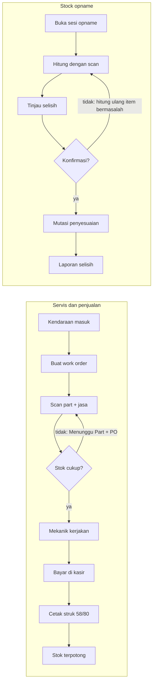
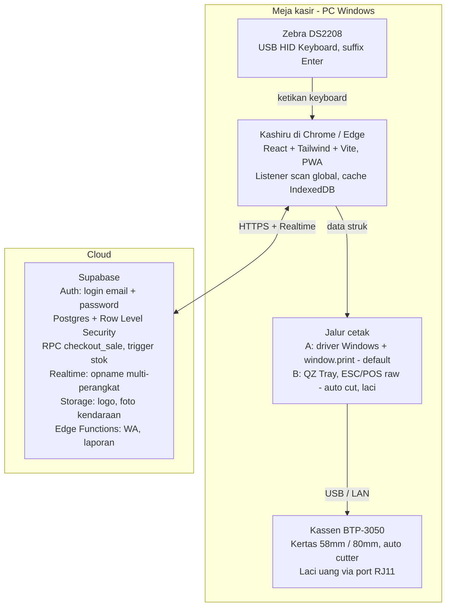

# PRD Kashiru — Aplikasi Kasir Bengkel & Sparepart

18 Oktober 2026 · Daffa Hanifisyafiq

## 1. Ringkasan Produk

Kashiru adalah aplikasi kasir (POS) berbasis web untuk bengkel motor dan mobil yang juga menjual sparepart. Kashiru menggabungkan penjualan sparepart, tagihan jasa servis, dan kontrol stok dalam satu layar yang cepat dipakai di meja kasir.

**Masalah yang diselesaikan**

- Stok sparepart sering tidak cocok antara catatan dan rak, sehingga barang "ada di sistem" tapi kosong di gudang.
- Satu jenis part punya banyak kode (OEM, aftermarket, KW), sulit dicari cepat saat pelanggan menunggu.
- Nota jasa servis dan nota sparepart terpisah, sehingga omzet bengkel sulit dihitung.
- Stock opname manual memakan waktu satu hari penuh dan rawan salah hitung.

**Visi**: kasir bengkel bisa menyelesaikan satu transaksi (scan part + jasa + bayar + cetak) dalam kurang dari 60 detik, dan pemilik tahu nilai stok riil setiap saat.

**Tujuan & metrik sukses (6 bulan setelah rilis)**

| Tujuan | Metrik | Target |
| --- | --- | --- |
| Transaksi cepat | Waktu rata-rata checkout (scan pertama → struk tercetak) | < 60 detik |
| Stok akurat | Selisih stok sistem vs fisik saat opname | < 2% item |
| Opname efisien | Durasi stock opname 1.000 SKU | < 3 jam |
| Tidak kehabisan barang | Item fast-moving yang kosong (stockout) per bulan | < 5 SKU |
| Adopsi | Transaksi harian yang tercatat di Kashiru | 100% |

## 2. Pengguna

Kashiru dipasang untuk satu bengkel dan dipakai langsung oleh pemilik dan kasir, dengan login, tetapi tanpa peran dan tanpa pembatasan akses antar akun.

- Setelah login, semua menu terbuka untuk setiap akun; tidak ada sistem role. Nama akun yang login dicatat di setiap nota dan riwayat perubahan.
- Mekanik bukan pengguna aplikasi; nama mekanik hanya dicatat sebagai data untuk jasa di work order dan laporan.
- Aplikasi bisa dibuka di beberapa perangkat sekaligus (PC kasir dan tablet untuk opname) dengan data yang sama secara realtime.
- Aksi berisiko (void transaksi, penyesuaian stok, ubah harga) cukup meminta konfirmasi dan tercatat di riwayat perubahan.

## 3. Ruang Lingkup

Semua modul di bawah dikerjakan dalam satu fase dan dirilis bersamaan.

| Modul | Catatan |
| --- | --- |
| Master barang (sparepart & jasa) | Kategori, kompatibilitas kendaraan, multi-barcode |
| Ketersediaan & mutasi stok | Kartu stok, stok minimum, status stok per kategori |
| Stock opname | Opname penuh dan per kategori dengan scanner |
| Scan barcode (Zebra DS2208) | Mode keyboard HID, tanpa driver |
| POS kasir & pembayaran | Tunai, QRIS, transfer, EDC, split payment |
| Cetak struk 58mm & 80mm (Kassen BTP-3050) | Template per ukuran, cetak ulang |
| Work order servis | Jasa + part dalam satu nota |
| Pelanggan & kendaraan | Riwayat servis per plat nomor |
| Pembelian & supplier | PO, penerimaan barang, hutang supplier |
| Retur penjualan & pembelian | Stok otomatis kembali / berkurang |
| Rekap harian (tutup hari) | Kas awal, kas fisik, selisih, rekap per metode bayar |
| Laporan & dashboard | Penjualan, laba kotor, stok, jasa mekanik |
| Cetak label barcode | Untuk part tanpa barcode pabrik |
| Piutang / tempo pelanggan | Untuk pelanggan fleet / langganan |
| Komisi mekanik | Per jasa atau persentase |
| Pengingat servis via WhatsApp | Berdasarkan km atau tanggal |
| Mode offline | Transaksi tetap jalan saat internet putus, sinkron otomatis |
| Login & akun | Email + password via Supabase Auth, semua akun setara |

**Di luar cakupan**: peran dan hak akses, shift kasir, lokasi rak, multi-cabang, booking online, integrasi e-Faktur, akuntansi lengkap, penggajian, dan aplikasi mobile native.

## 4. Fitur Inti

### 4.1 Master Barang

Setiap sparepart punya satu SKU internal tetapi boleh punya banyak barcode dan kode part, karena satu part bisa datang dari beberapa merek.

- Field wajib: SKU, nama, kategori (oli, kampas rem, busi, aki, ban, filter, dll.), merek, satuan, harga beli, harga jual, stok minimum. Barang hanya dikelompokkan per kategori (satu tingkat, tanpa sub-kategori dan tanpa lokasi rak).
- Multi-barcode: barcode pabrik (EAN-13 / Code128) dan barcode internal Kashiru.
- Kode part OEM + kode alternatif (aftermarket / KW) yang saling terhubung sebagai substitusi.
- Kompatibilitas kendaraan: part ditautkan ke merek, model, dan tahun (mis. Honda Vario 125 2018-2022).
- Multi-satuan dengan konversi: liter ↔ botol, dus ↔ pcs, meter untuk kabel.
- Multi-harga: harga eceran, harga bengkel rekanan, harga member.
- Barang jasa (non-stok): ganti oli, tune up, servis CVT, dengan tarif dan estimasi waktu.
- Impor massal dari Excel/CSV untuk migrasi awal.

### 4.2 Ketersediaan & Mutasi Stok

Stok dihitung dari buku mutasi (ledger), bukan angka yang diedit langsung, sehingga setiap perubahan bisa dilacak.

- Kartu stok per item: tanggal, jenis mutasi (jual, beli, retur, opname, transfer, pemakaian servis), qty masuk/keluar, saldo, user.
- Indikator status: Aman, Menipis (≤ stok minimum), Habis, Overstock.
- Notifikasi stok menipis di dashboard dan daftar saran belanja (reorder) otomatis.
- Stok tersedia vs stok dipesan: part yang sudah masuk work order tetapi belum dibayar dihitung sebagai "dipesan".
- Laporan barang slow-moving (tidak terjual > 90 hari) dan fast-moving.
- Valuasi stok dengan metode rata-rata tertimbang (average cost).
- Pencarian kilat: nama, SKU, barcode, kode OEM, atau model kendaraan, dengan filter kategori.

### 4.3 Stock Opname

Opname dilakukan per sesi dengan alur hitung → tinjau → konfirmasi; stok sistem hanya berubah setelah penyesuaian dikonfirmasi.

- Jenis sesi: opname penuh, opname per kategori, dan cycle count harian (mis. 20 item acak per hari).
- Mode blind count: penghitung tidak melihat stok sistem agar hasil jujur.
- Hitung dengan scanner: setiap scan menambah qty 1; tombol angka untuk qty besar.
- Bisa beberapa penghitung sekaligus di perangkat berbeda (realtime via Supabase).
- Snapshot stok sistem diambil saat sesi dibuka; transaksi selama opname tetap dicatat dan dihitung ulang saat rekonsiliasi.
- Laporan selisih: qty dan nilai rupiah per item, dengan alasan (rusak, hilang, salah input).
- Konfirmasi penyesuaian membuat mutasi "penyesuaian opname" di kartu stok.
- Ekspor hasil opname ke PDF dan Excel.

### 4.4 Scan Barang (Zebra DS2208)

Scanner dipasang di mode USB HID Keyboard, sehingga browser menerima hasil scan sebagai ketikan keyboard tanpa driver tambahan. DS2208 juga punya mode USB CDC (serial) untuk aplikasi yang membaca data serial; Kashiru tidak memerlukannya ([referensi mode HID & CDC](https://www.cleverence.com/articles/usb-barcode-scanners-de/quick-steps-to-enable-usb-hid-mode-on-ds2208-5837291/)).

- Konfigurasi scanner: USB HID Keyboard, suffix Enter (CR), layout keyboard US. Panduan barcode konfigurasi disertakan di menu Pengaturan.
- Deteksi scan global: listener membedakan scan dan ketikan manusia dari kecepatan (karakter masuk < 30 ms per karakter, diakhiri Enter, panjang ≥ 4).
- Scan berfungsi di layar mana pun: di POS menambah item ke keranjang, di opname menambah hitungan, di penerimaan barang menambah qty terima.
- Scan barcode yang sama lagi = qty +1.
- Barcode tidak dikenal: muncul dialog "Daftarkan barang baru" atau "Tautkan ke barang yang ada".
- Umpan balik: bunyi beep sukses / gagal di aplikasi, plus kilatan visual pada baris item.
- Dukungan 1D & 2D: EAN-13, Code128, dan QR (mis. QR berisi nomor work order untuk memanggil nota).

### 4.5 Cetak Struk 58mm & 80mm (Kassen BTP-3050)

BTP-3050 adalah printer thermal ESC/POS yang mendukung kertas 80mm dan 58mm, lebar cetak 72mm, 203 DPI, 220mm/s, auto cutter, dan port RJ11 untuk laci uang; varian koneksinya USB + Bluetooth atau USB + Ethernet ([spesifikasi](https://mymegatronix.co.id/btp-3050-bt-ue-2-sku/), [Kassen](https://kassen.com.tw/products/receipt-printer/btp-3050/)).

| Ukuran kertas | Lebar area cetak | Lebar (dot, 203 DPI) | Karakter per baris (Font A) | Penggunaan |
| --- | --- | --- | --- | --- |
| 58mm | ±48mm | 384 | 32 | Nota ringkas penjualan part |
| 80mm | 72mm | 576 | 48 | Nota servis lengkap dengan rincian jasa & part |

- Pengaturan per perangkat kasir: ukuran kertas default, nama printer, jumlah salinan, auto cut, buka laci otomatis.
- Template struk: logo bengkel (monokrom), nama & alamat, no. nota, tanggal, kasir (nama akun yang login), plat nomor & km kendaraan, daftar part, daftar jasa + mekanik, subtotal, diskon, pajak (opsional), total, metode bayar, kembalian, footer (garansi part, catatan servis berikutnya), QR nomor nota.
- Dokumen cetak: struk penjualan, nota work order (estimasi), struk retur, rekap harian, label barcode.
- Cetak ulang dari riwayat transaksi dengan tanda "SALINAN".
- Fallback: kirim struk digital via WhatsApp / PDF jika printer bermasalah.
- Metode cetak dijelaskan di bagian Arsitektur Teknis (8.3).

### 4.6 POS Kasir

Layar kasir dirancang untuk keyboard + scanner, tanpa perlu mouse.

- Keranjang berisi dua jenis baris: part (stok) dan jasa (non-stok), masing-masing bisa diberi mekanik.
- Pintasan keyboard: F2 cari barang, F4 pilih pelanggan, F8 diskon, F9 bayar, F12 cetak ulang, Esc batal.
- Diskon per item dan per nota (nominal atau persen).
- Pembayaran: tunai (tombol uang pas & pecahan cepat), QRIS, transfer, kartu debit/EDC, split payment.
- Tahan transaksi (hold) untuk melayani pelanggan lain, lalu lanjutkan.
- Harga otomatis mengikuti golongan pelanggan.
- Validasi stok: peringatan jika qty melebihi stok tersedia, tetap bisa dilanjutkan dengan konfirmasi.

## 5. Fitur Wajib Tambahan (Rekomendasi)

Tujuh fitur di bawah ini wajib karena tanpanya bengkel tetap butuh buku catatan atau aplikasi lain, dan stok akan kembali tidak akurat.

### 5.1 Work Order Servis

Bengkel menjual jasa dan part sekaligus, jadi transaksi dimulai dari work order (WO), bukan langsung dari kasir.

- Status WO: Antre → Dikerjakan → Menunggu Part → Selesai → Dibayar → Diambil.
- Data: plat nomor, km saat masuk, keluhan, mekanik, estimasi biaya, foto kondisi kendaraan (opsional).
- Part yang ditambahkan ke WO langsung tercatat "dipesan" dan berkurang dari stok saat WO dibayar.
- Cetak estimasi biaya untuk persetujuan pelanggan sebelum dikerjakan.
- Papan antrean (kanban) untuk melihat kendaraan yang sedang di bengkel.

### 5.2 Pelanggan & Kendaraan

- Satu pelanggan bisa punya banyak kendaraan; pencarian utama lewat plat nomor.
- Riwayat servis dan part yang pernah dipasang per kendaraan.
- Jadwal servis berikutnya (km atau tanggal) dicetak di struk.
- Golongan harga: umum, member, bengkel rekanan.

### 5.3 Pembelian & Supplier

- Purchase Order (PO) ke supplier, bisa dibuat dari daftar saran reorder.
- Penerimaan barang dengan scanner: cocokkan qty terima vs PO, catat selisih.
- Harga beli terakhir tersimpan dan memperbarui harga rata-rata.
- Hutang supplier: jatuh tempo, pembayaran sebagian, pengingat.

### 5.4 Retur

- Retur penjualan (part salah / cacat): stok kembali atau masuk gudang "rusak".
- Retur pembelian ke supplier: stok berkurang, hutang berkurang.
- Klaim garansi part dengan referensi nota asal.

### 5.5 Rekap Harian (Tutup Hari)

Tidak ada shift kasir; semua transaksi dalam satu hari direkap sekali saat tutup hari.

- Buka hari: isi kas awal, otomatis terisi dari sisa kas hari sebelumnya.
- Kas keluar harian (beli bensin, makan, ongkos kirim) dicatat dengan keterangan.
- Tutup hari: masukkan uang fisik, sistem menampilkan kas seharusnya dan selisihnya.
- Rekap per metode bayar (tunai, QRIS, transfer, EDC), jumlah nota, serta omzet jasa vs part, dicetak ke printer struk bersama nama akun yang menutup hari.
- Rekap yang sudah ditutup bisa dibuka ulang untuk koreksi, dan perubahannya tercatat di riwayat.

### 5.6 Laporan & Dashboard

- Dashboard: omzet hari ini, laba kotor, jumlah kendaraan, WO aktif, stok menipis.
- Laporan penjualan per periode, per kategori, per metode bayar.
- Laporan jasa & produktivitas mekanik.
- Laporan stok: nilai persediaan, kartu stok, slow-moving, selisih opname.
- Laporan pembelian & hutang supplier.
- Ekspor semua laporan ke Excel dan PDF.

### 5.7 Login & Riwayat Perubahan

- Login dengan email dan password; sesi tersimpan di perangkat, jadi cukup login sekali sampai logout atau sesi habis.
- Riwayat mencatat void, diskon, edit harga, dan penyesuaian stok beserta waktu dan akun yang melakukannya. Nota, work order, retur, PO, kas keluar, opname, dan rekap harian juga menyimpan akun pembuatnya.
- Aksi berisiko memakai dialog konfirmasi, bukan persetujuan atasan.
- Pengamanan data di sisi server dijelaskan di bagian 10.

### 5.8 Fitur Pelengkap

- Cetak label barcode untuk part tanpa barcode pabrik.
- Piutang / bayar tempo untuk pelanggan fleet.
- Komisi mekanik otomatis.
- Pengingat servis via WhatsApp.
- Mode offline dengan sinkronisasi otomatis.

## 6. User Flow Utama

Dua alur ini menentukan akurasi stok: penjualan mengurangi stok hanya saat dibayar, dan opname mengubah stok hanya setelah penyesuaian dikonfirmasi.



Pembeli eceran tanpa servis langsung masuk di langkah scan part, tanpa work order. Part di work order yang belum dibayar tercatat sebagai stok dipesan agar tidak terjual dua kali.

## 7. Panduan UI/UX (taste-skill)

UI Kashiru dibangun dengan [Taste Skill](https://www.tasteskill.dev/) v2 (`design-taste-frontend`) dikombinasikan dengan `minimalist-skill`, karena POS butuh UI produk yang padat, tegas, dan tidak dekoratif.

**Instalasi di proyek**

```bash
npx skills add https://github.com/Leonxlnx/taste-skill --skill "design-taste-frontend"
npx skills add Leonxlnx/taste-skill --skill minimalist-skill
npx skills add Leonxlnx/taste-skill --skill output-skill
```

`output-skill` dipakai agar agen AI tidak meninggalkan placeholder atau bagian setengah jadi ([daftar skill](https://www.tasteskill.dev/docs)).

**Design brief untuk agen (ditaruh di atas SKILL.md)**

> Kashiru: aplikasi kasir & gudang bengkel motor/mobil. Pengguna: pemilik dan kasir bengkel di lingkungan bengkel yang terang, berdebu, sering memakai sarung tangan. Arah desain: utilitarian, editorial product UI ala Linear/Notion, data-dense, bukan landing page. Stack: React + Tailwind + shadcn/ui.

**Aturan visual yang diambil dari taste-skill**

- Color Consistency Lock: satu warna aksen di seluruh aplikasi (usulan: oranye industri / amber) di atas basis abu-abu netral. Tanpa gradien ungu atau mesh blob ([locks & bans](https://www.tasteskill.dev/docs)).
- Shape Consistency Lock: satu sistem radius, usulan radius kecil 6px untuk semua kartu, input, dan tombol.
- Theme Lock + Dark mode protocol: dukung terang dan gelap dengan kontras WCAG AA, memakai off-white dan off-black, bukan putih/hitam murni.
- Warna semantik hanya untuk makna nyata: hijau Aman, kuning Menipis, merah Habis. Status dot dekoratif dilarang.
- Hindari baris kartu tiga sama besar dan UI tiruan; dashboard memakai grid asimetris (angka utama besar, grafik di sampingnya).
- Tanpa em-dash di copy UI; gunakan bahasa Indonesia yang singkat dan jelas.

**Aturan khusus POS bengkel (tambahan Kashiru)**

- Target sentuh minimal 44px, tombol bayar minimal 56px tinggi.
- Angka memakai font tabular (mis. `font-variant-numeric: tabular-nums`) agar kolom harga rata.
- Format Rupiah konsisten: `Rp 125.000`, tanpa desimal.
- Layar POS dua kolom: kiri pencarian + keranjang, kanan ringkasan total + tombol bayar yang selalu terlihat.
- Fokus input selalu kembali ke kolom scan setelah setiap aksi, agar scanner tidak kehilangan input.
- Resolusi target: monitor kasir 1366×768 ke atas dan tablet 10 inci untuk opname.
- Pre-flight check taste-skill dijalankan untuk setiap halaman sebelum merge.

## 8. Arsitektur Teknis

Kashiru adalah single-page app React yang berbicara langsung ke Supabase; scanner tidak butuh driver, dan printer dicetak lewat driver Windows sebagai jalur default.



### 8.1 Stack

| Lapisan | Pilihan | Alasan |
| --- | --- | --- |
| Frontend | React 18 + Vite + TypeScript | Build cepat, tipe data aman untuk uang & stok |
| Styling | Tailwind CSS + shadcn/ui | Sesuai peta design system taste-skill |
| State & data | TanStack Query + Zustand | Cache server state, keranjang di state lokal |
| Form & validasi | React Hook Form + Zod | Validasi input harga, qty, plat nomor |
| Tabel data | TanStack Table | Daftar barang & laporan ribuan baris |
| Cache lokal | IndexedDB (Dexie) | Master barang untuk scan instan dan antrean offline |
| Backend | Supabase (Postgres, Auth, Realtime, Storage, Edge Functions) | Sesuai permintaan; Supabase Auth + RLS (lihat 8.4) |
| Cetak | CSS `@page` + `window.print()`; opsi QZ Tray untuk ESC/POS | Lihat 8.3 |
| Hosting | Vercel atau Netlify | Statis, HTTPS otomatis |

### 8.2 Integrasi Scanner Zebra DS2208

1. Scan barcode konfigurasi "USB HID Keyboard" dan "Add Enter key" dari Product Reference Guide Zebra.
2. Hook `useBarcodeScanner` memasang listener `keydown` global, mengumpulkan karakter yang masuk dengan jeda < 30 ms, dan memicu event `onScan(kode)` saat menerima Enter.
3. Jika fokus sedang di input teks biasa (mis. catatan keluhan), scan tetap ditangkap dan karakter tidak dimasukkan ke input tersebut.
4. Kode dicari dulu di cache IndexedDB, lalu dikonfirmasi ke Supabase di latar belakang.

### 8.3 Metode Cetak ke Kassen BTP-3050

Aplikasi web tidak bisa mengirim perintah langsung ke printer USB tanpa bantuan, jadi Kashiru menyediakan dua jalur cetak yang bisa dipilih per perangkat.

| Jalur | Cara kerja | Kelebihan | Kekurangan | Rekomendasi |
| --- | --- | --- | --- | --- |
| A. Driver + browser print | Install driver BTP-3050, set ukuran kertas 58/80mm, React render template HTML struk dengan CSS `@page { size: 58mm auto }` / `80mm auto`, lalu `window.print()`. Chrome dijalankan dengan flag `--kiosk-printing` agar tanpa dialog | Tanpa software tambahan, mendukung logo & font | Auto cut & buka laci tergantung pengaturan driver | Default |
| B. QZ Tray (ESC/POS raw) | Aplikasi kecil di PC kasir menerima perintah dari browser dan mengirim byte ESC/POS ke printer | Cetak senyap, kontrol penuh auto cut, buka laci, QR native | Perlu install QZ Tray & sertifikat | Opsi di pengaturan, untuk laci uang otomatis |
| C. Web Serial / WebUSB | Browser Chrome langsung ke port printer | Tanpa aplikasi lokal | Di Windows sering bentrok dengan driver, dukungan terbatas | Tidak disarankan |

Template struk ditulis sekali sebagai komponen React yang menerima prop `paperWidth` (58 atau 80), sehingga lebar kolom, ukuran font, dan pemotongan teks menyesuaikan otomatis.

### 8.4 Login

Kashiru memakai Supabase Auth dengan email dan password, tanpa peran; setiap akun yang login punya akses penuh yang sama.

1. Akun pertama (pemilik) dibuat saat instalasi; akun tambahan untuk kasir dibuat dari menu Pengaturan.
2. Sesi disimpan di perangkat dan diperbarui otomatis, jadi kasir tidak perlu login ulang setiap hari.
3. Logout otomatis setelah tidak aktif selama waktu yang bisa diatur (mis. 12 jam).
4. RLS mengizinkan baca/tulis hanya untuk user yang login dan berstatus aktif di `profiles`; anon key saja tidak bisa mengakses data.
5. Akun bisa dinonaktifkan dari Pengaturan bila kasir berhenti atau perangkat hilang.
6. Lupa password: reset lewat email dari Supabase Auth.

## 9. Skema Database (Supabase / PostgreSQL)

Kashiru memakai satu database untuk satu bengkel, tanpa tabel peran, shift, maupun outlet; stok hanya berubah lewat tabel `stock_movements`.

| Tabel | Kolom kunci | Keterangan |
| --- | --- | --- |
| `store_settings` | id (satu baris), nama_bengkel, alamat, telepon, logo_url, footer_struk, ppn_aktif | Profil bengkel |
| `profiles` | id (= auth.users), nama, email, aktif, terakhir_login | Akun login, semua setara (8.4) |
| `categories` | id, nama | Kategori satu tingkat |
| `products` | id, sku, nama, category_id, merek, tipe (part/jasa), satuan, harga_beli_avg, harga_jual, stok_min, aktif | Master barang & jasa |
| `product_barcodes` | id, product_id, barcode (unique), jenis | Multi-barcode |
| `product_part_numbers` | id, product_id, kode_part, jenis (OEM/alt) | Kode OEM & substitusi |
| `product_prices` | product_id, golongan, harga | Harga per golongan pelanggan |
| `vehicle_models` | id, merek, model, tahun_awal, tahun_akhir, jenis (motor/mobil) | Referensi kendaraan |
| `product_compatibility` | product_id, vehicle_model_id | Part cocok untuk kendaraan apa |
| `stock_levels` | product_id, qty_on_hand, qty_reserved | Saldo, diperbarui oleh trigger |
| `stock_movements` | id, product_id, jenis, qty, ref_type, ref_id, harga_satuan, user_id, created_at | Buku besar stok (append-only) |
| `mechanics` | id, nama, komisi_persen, aktif | Data mekanik, bukan pengguna |
| `customers` | id, nama, telepon, golongan, limit_piutang | Pelanggan |
| `vehicles` | id, customer_id, plat_nomor, vehicle_model_id, km_terakhir | Kendaraan pelanggan |
| `work_orders` | id, nomor, vehicle_id, mechanic_id, status, keluhan, km_masuk, estimasi, user_id | Work order servis |
| `sales` | id, nomor, tanggal, work_order_id, customer_id, subtotal, diskon, pajak, total, status, user_id | Header transaksi |
| `sale_items` | id, sale_id, product_id, qty, harga, diskon, mechanic_id | Baris part & jasa |
| `payments` | id, sale_id, metode, jumlah, referensi | Mendukung split payment |
| `receivables` | id, sale_id, customer_id, sisa, jatuh_tempo | Piutang pelanggan |
| `daily_closings` | tanggal (PK), kas_awal, tunai_sistem, kas_fisik, selisih, catatan, ditutup_pada, ditutup_oleh | Rekap harian |
| `cash_expenses` | id, tanggal, keterangan, jumlah, user_id | Kas keluar harian |
| `suppliers` | id, nama, telepon, termin_hari | Supplier |
| `purchase_orders` / `po_items` | id, supplier_id, status, jatuh_tempo, user_id / product_id, qty_pesan, qty_terima, harga | PO & penerimaan |
| `returns` / `return_items` | id, jenis (jual/beli), ref_id, alasan, user_id / product_id, qty, kondisi | Retur |
| `stock_opnames` | id, jenis (penuh/kategori/cycle), category_id, status, dibuka_pada, dikonfirmasi_pada, dikonfirmasi_oleh | Sesi opname |
| `stock_opname_items` | opname_id, product_id, qty_sistem_snapshot, qty_hitung, selisih, alasan, dihitung_oleh | Hasil hitung |
| `service_reminders` | id, vehicle_id, jenis (km/tanggal), target, terkirim_pada | Pengingat WhatsApp |
| `change_logs` | id, user_id, aksi, entitas, entitas_id, data_lama, data_baru, created_at | Riwayat perubahan |
| `printer_settings` | device_id, ukuran_kertas (58/80), metode, auto_cut, buka_laci, salinan | Pengaturan printer per perangkat |

**Aturan integritas**

- RLS di semua tabel: hanya user login yang terdaftar di `profiles` yang aktif boleh membaca dan menulis.
- `stock_movements` hanya boleh INSERT (tanpa UPDATE/DELETE); koreksi dibuat sebagai mutasi baru.
- Trigger `after insert` pada `stock_movements` memperbarui `stock_levels` dan `harga_beli_avg`.
- Checkout dijalankan sebagai satu fungsi RPC Postgres (`checkout_sale`) dalam satu transaksi: buat sale, item, payment, mutasi stok, lalu kembalikan nomor nota. Gagal satu, batal semua.
- Nomor nota berurutan per hari, mis. `KSR-20261018-0001`, dibuat oleh sequence di database. Kolom `user_id` dan `*_oleh` (mengacu ke `profiles`) diisi otomatis dari `auth.uid()` di database, bukan dari frontend.

```sql
-- Contoh: mutasi stok saat penjualan (di dalam fungsi checkout_sale)
insert into stock_movements (product_id, jenis, qty, ref_type, ref_id, harga_satuan, user_id)
select si.product_id, 'sale', -si.qty, 'sale', s.id, si.harga, auth.uid()
from sale_items si
join sales s on s.id = si.sale_id
join products p on p.id = si.product_id
where s.id = p_sale_id and p.tipe = 'part';
```

## 10. Kebutuhan Non-Fungsional

| Aspek | Kebutuhan | Target / Cara |
| --- | --- | --- |
| Performa scan | Item muncul di keranjang setelah scan | < 300 ms (cache master barang di IndexedDB) |
| Performa cetak | Struk keluar setelah tekan Bayar | < 3 detik |
| Pencarian | Hasil pencarian 10.000 SKU | < 500 ms (index trigram `pg_trgm`) |
| Akses | Login sebelum memakai aplikasi | Supabase Auth email + password, sesi tersimpan per perangkat (8.4) |
| Keamanan data | Database tidak bisa diakses dari luar perangkat bengkel | Row Level Security Supabase di semua tabel, hanya untuk user login yang aktif |
| Perangkat bersama | PC kasir dipakai banyak orang | Logout otomatis saat tidak aktif + kunci layar Windows |
| Ketahanan internet | Transaksi tetap jalan saat koneksi putus | Mode offline dengan antrean lokal dan sinkron otomatis |
| Backup | Data tidak hilang | Backup harian Supabase (Point-in-Time Recovery pada paket Pro) + ekspor mingguan |
| Browser | Kompatibilitas | Chrome / Edge versi terbaru di Windows (wajib untuk cetak & kiosk mode) |
| Aksesibilitas | Mudah dibaca di bengkel | Kontras WCAG AA, teks minimal 14px, target sentuh 44px |
| Riwayat | Jejak perubahan | Aksi berisiko di `change_logs`, tidak bisa dihapus |
| Zona waktu & format | Konsisten lokal | WIB (Asia/Jakarta), Rupiah tanpa desimal, tanggal DD/MM/YYYY; tutup hari mengikuti tanggal WIB |

## 11. Risiko & Pertanyaan Terbuka

Risiko terbesar ada di cetak lewat browser dan kerapian data barang awal; keduanya diuji di minggu pertama pengembangan.

**Risiko & mitigasi**

| Risiko | Dampak | Mitigasi |
| --- | --- | --- |
| Internet bengkel tidak stabil | Kasir tidak bisa transaksi | Mode offline: cache IndexedDB + antrean transaksi, sinkron otomatis |
| Browser print menampilkan dialog / margin salah | Struk terpotong, kasir lambat | Kiosk printing, ukuran kertas di driver, uji di minggu pertama, opsi QZ Tray |
| Data awal barang berantakan (tanpa barcode, nama tidak seragam) | Scan gagal, stok tidak akurat | Impor Excel dengan validasi, cetak label barcode internal, opname awal sebelum go-live |
| Scan masuk ke kolom input yang salah | Data kotor | Listener global memotong input scan dari field teks |
| PC kasir ditinggal dalam keadaan login | Harga atau stok diubah tanpa izin | Logout otomatis saat tidak aktif, riwayat perubahan per akun, dialog konfirmasi |
| URL aplikasi & anon key Supabase diketahui pihak luar | Data toko terbuka | Login + RLS (8.4), akun bisa dinonaktifkan |
| Kasir menolak sistem baru | Transaksi tetap manual | Pintasan keyboard, pelatihan 1 jam |

**Pertanyaan terbuka**

- [ ] Apakah bengkel sudah PKP sehingga struk perlu PPN?
- [ ] Berapa jumlah SKU dan berapa barang yang belum punya barcode?
- [ ] Varian BTP-3050 yang dipakai: USB + Bluetooth atau USB + LAN?
- [ ] Berapa perangkat yang dipakai bersamaan (PC kasir, tablet opname)?
- [ ] Metode pembayaran QRIS memakai penyedia apa (static QR atau terintegrasi)?
- [ ] Skema komisi mekanik: nominal tetap per jasa atau persentase?

**Sumber**: [Taste Skill](https://www.tasteskill.dev/), [Taste Skill Docs](https://www.tasteskill.dev/docs), [Kassen BTP 3050](https://kassen.com.tw/products/receipt-printer/btp-3050/), [Spesifikasi BTP 3050 (Megatronix)](https://mymegatronix.co.id/btp-3050-bt-ue-2-sku/), [Mode USB HID DS2208](https://www.cleverence.com/articles/usb-barcode-scanners-de/quick-steps-to-enable-usb-hid-mode-on-ds2208-5837291/).
